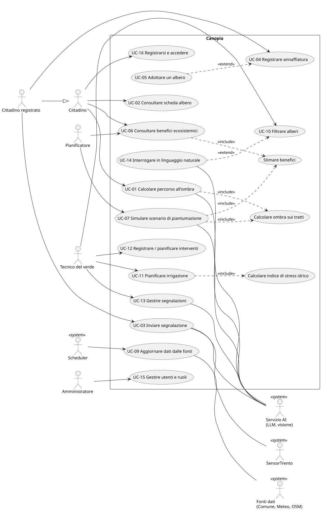
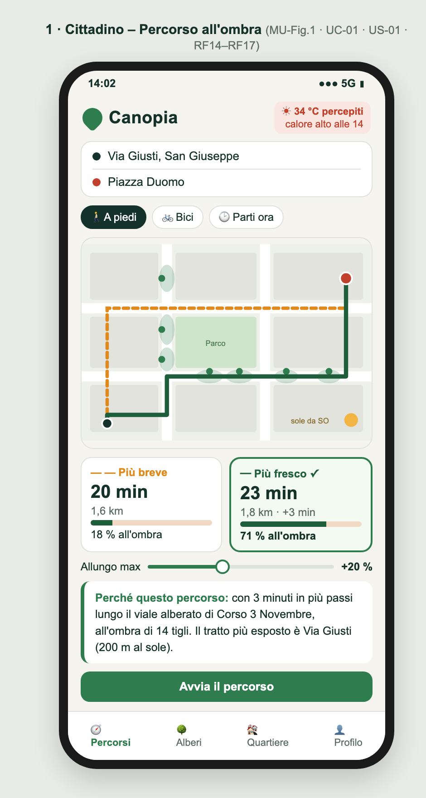
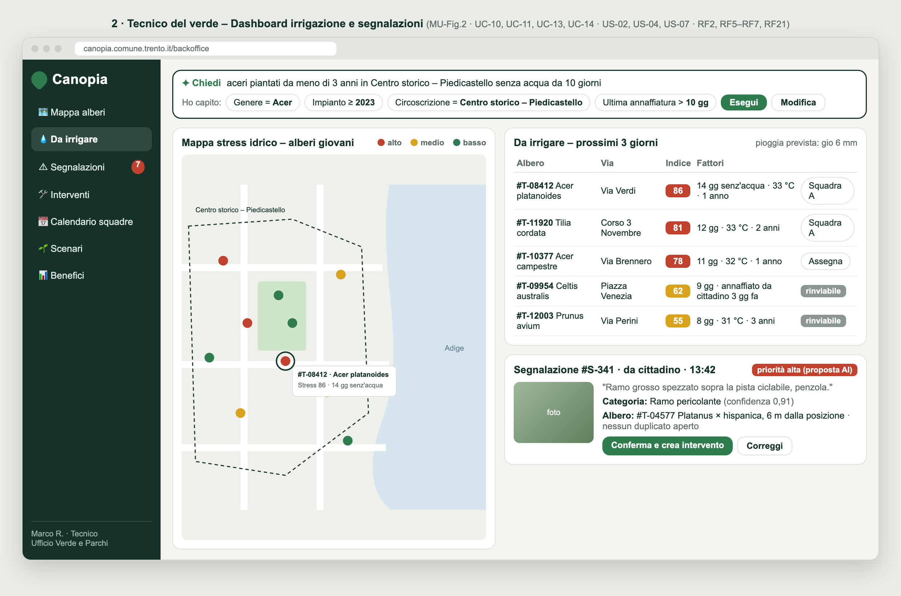
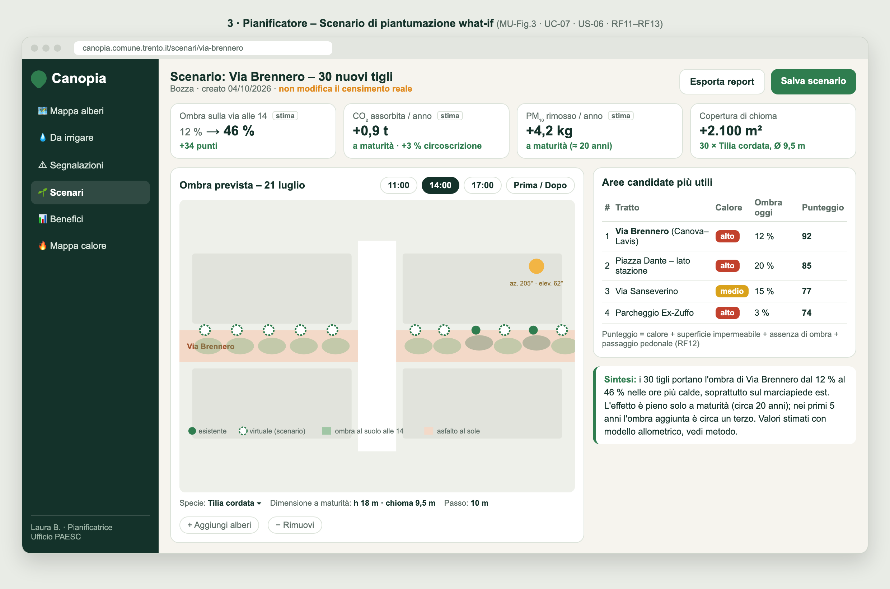
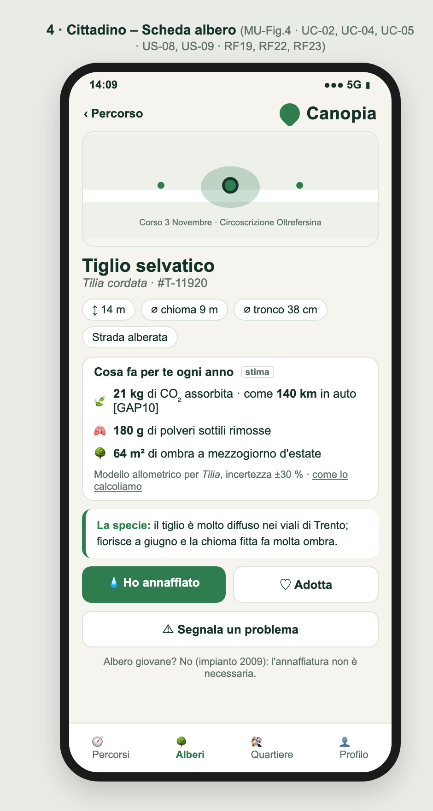
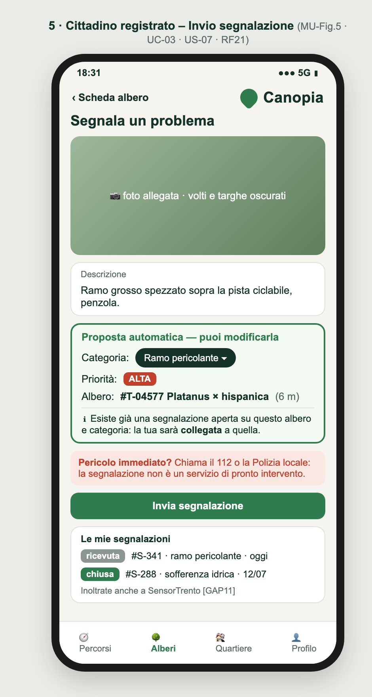
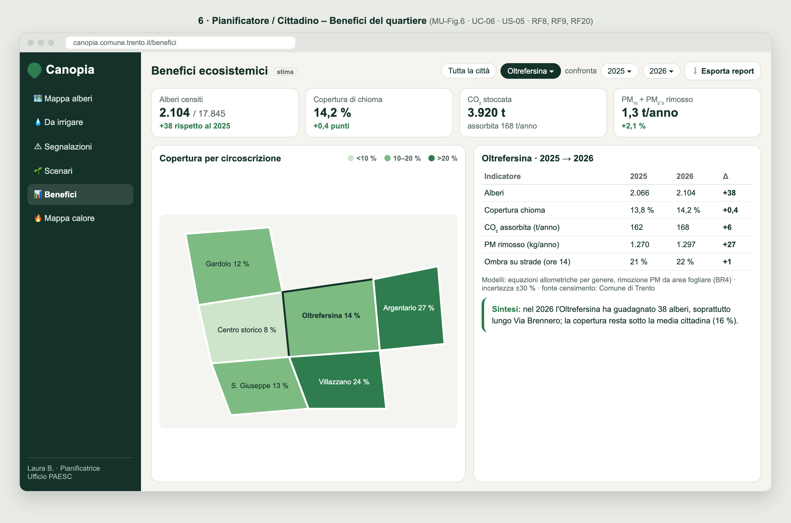
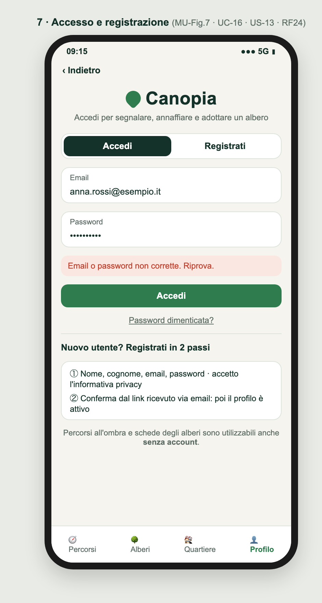

# D1 – Descrizione di Progetto

**Progetto:** Canopia – gemello digitale della copertura arborea di Trento: benefici ecosistemici, irrigazione mirata e percorsi all'ombra
**Corso:** Ingegneria del Software, A.A. 2026-27 – Prof. Paolo Giorgini
**Gruppo:** [Nome 1 (team leader)], [Nome 2], [Nome 3]
**Versione:** 0.3 (bozza, allineata al template D1 V1.2) – 02/11/2026

> Bozza di lavoro. Le parti tra `[ ]` sono da completare. I GAP sono segnalati, non inventati.

---

| Document Info | |
|---|---|
| Doc. Name | D1-CanopiaDescrizioneProgetto |
| Doc. Number | D1 V0.3 |
| Description | Documento di Requirements Engineering: progetto, requisiti funzionali e non funzionali, Use Case, User Story, Acceptance Criteria, mockup e traceability |

## Note D1

- **Ruolo del documento.** Il D1 descrive il problema da risolvere e ciò che il sistema deve fare dal punto di vista del committente (Comune di Trento) e degli utenti. È la baseline iniziale del Requirements Engineering e l'input dei deliverable successivi; non anticipa decisioni tecniche che appartengono a D2–D4.
- **Identificatori e traceability.** Gli identificatori RF*, RNF*, UC-XX, US-XX, AC-USXX-YY, MU-Fig.N, BR*, GAP* e CH-XX sono stabili. Gli artefatti successivi li riusano per costruire la catena Requirement → Specification → Code → Test → Verification.
- **Living requirements e GitHub.** Dopo l'approvazione come baseline il D1 può evolvere durante gli sprint: il documento rappresenta lo stato corrente approvato, mentre GitHub conserva la storia delle modifiche (Issue, commit, Pull Request, review). Le modifiche significative sono riassunte nella sezione 9.
- **Convenzioni.** Priorità MoSCoW: M = Must, S = Should, C = Could. I valori tra `[ ]` sono soglie da validare con il Comune.

---

## 1. Il progetto Canopia

### 1.1 Slide del pitch
[Inserire le slide presentate al Comune: Problema, Soluzione, Vantaggi.]

### 1.2 Problema
Il Comune di Trento ha censito circa **17.800 alberi** pubblici vivi (posizione, specie, altezza, diametro del tronco e della chioma). Il censimento oggi è consultabile solo come mappa sul portale cartografico comunale: è un archivio, non uno strumento di decisione.

Allo stesso tempo:
- il Comune ha individuato **110 aree critiche per il calore** di proprietà comunale (progetto europeo Selina), tra parcheggi, piazze e strade, sovrapponendo il patrimonio comunale alla mappa delle temperature;
- il **Piano del Verde 2025** prevede 155 km di strade ombreggiate e il **PAESC** chiede di misurare il contributo del verde alla mitigazione climatica;
- nelle giornate calde chi si sposta a piedi o in bici non ha modo di sapere quali strade sono all'ombra;
- gli alberi giovani soffrono la siccità estiva: il telecontrollo comunale dell'irrigazione gestisce gli impianti fissi, ma non gli alberi di strada annaffiati a mano;
- i cittadini segnalano i problemi del verde (rami pericolanti, piante sofferenti) tramite **SensorTrento**, ma la segnalazione è un punto sulla mappa con testo libero, non collegato al singolo albero censito né al suo storico.

Nessuno strumento collega i dati degli alberi al loro **effetto** (ombra, CO₂, polveri, raffrescamento) e lo rende utilizzabile sia dal Comune sia dai cittadini.

### 1.3 Soluzione proposta
Canopia è un'applicazione web, accessibile da browser senza installazioni, che trasforma il censimento degli alberi in un **gemello digitale** della copertura arborea. Si rivolge a quattro categorie di utenti: tecnico del verde, pianificatore, cittadino e amministratore.

- Il **tecnico del verde** consulta e filtra gli alberi, registra e pianifica interventi, riceve l'elenco prioritario degli alberi giovani da irrigare e gestisce le segnalazioni dei cittadini.
- Il **pianificatore** vede i benefici ecosistemici stimati per albero, quartiere e città, la mappa delle aree più calde e simula scenari di nuove piantumazioni.
- Il **cittadino** ottiene percorsi a piedi e in bici che privilegiano i tratti all'ombra, consulta la scheda degli alberi e, se registrato, segnala problemi, registra annaffiature e adotta un albero.
- L'**amministratore** gestisce utenti, ruoli e aggiornamento dei dati.

### 1.4 Obiettivi
| ID | Obiettivo |
|---|---|
| OB1 | Dare all'Ufficio Verde una visione unica dello stato degli alberi, per pianificare manutenzione e irrigazione in modo proattivo |
| OB2 | Stimare e rendere visibili i benefici ecosistemici di ogni albero e di ogni quartiere (CO₂, PM₁₀/PM₂.₅, ombra), a supporto del monitoraggio PAESC |
| OB3 | Supportare la scelta di dove piantare nuovi alberi con simulazioni what-if |
| OB4 | Offrire ai cittadini percorsi a piedi e in bici che privilegiano tratti all'ombra nelle ore calde |
| OB5 | Coinvolgere i cittadini nella cura degli alberi (segnalazioni, annaffiatura) e nell'educazione ambientale |
| OB6 | Usare dati del Comune e dati aperti esistenti, dichiarando in modo esplicito le stime |

### 1.5 Ruolo dell'AI
L'AI ha ruoli funzionali precisi, non quello di chatbot generico:
1. **Interrogazione in linguaggio naturale del gemello digitale (back-office):** il tecnico scrive *"aceri piantati da meno di 3 anni in Circoscrizione Centro storico – Piedicastello senza annaffiature da 10 giorni"* e il sistema la traduce in filtri strutturati, mostrati prima dell'esecuzione.
2. **Triage delle segnalazioni dei cittadini:** da foto e testo il sistema propone categoria (ramo pericolante, sofferenza idrica, malattia, altro), priorità e albero censito più probabile, e individua i duplicati. Il tecnico conferma o corregge.
3. **Spiegazione:** traduce in linguaggio comprensibile il risultato di un percorso all'ombra o di uno scenario what-if (*"questo percorso è 4 minuti più lungo ma il 70 % è all'ombra"*).

**Ombra, benefici ecosistemici, indice di stress idrico e punteggio delle aree da piantare sono calcolati con modelli deterministici e trasparenti** (sezione 11): l'AI li interpreta e li spiega, non li decide.

### 1.6 Vantaggi per il Comune
- **Manutenzione e irrigazione proattive:** l'elenco prioritario degli alberi giovani a rischio siccità aiuta a usare meglio le squadre disponibili nei mesi estivi.
- **Supporto al PAESC e al Piano del Verde:** stime di CO₂, polveri e ombra per quartiere, confrontabili nel tempo, utili alla rendicontazione del contributo del verde.
- **Decisioni di piantumazione basate sui dati:** gli scenari what-if mostrano prima dell'intervento quanta ombra e quanti benefici aggiunge un nuovo filare.
- **Valorizzazione di dati già raccolti:** il censimento degli alberi diventa uno strumento operativo, senza nuove campagne di rilievo.
- **Segnalazioni più utili:** le segnalazioni sul verde sono collegate al singolo albero e al suo storico, e arrivano già classificate per categoria e priorità.

### 1.7 Vantaggi per i cittadini
- **Spostamenti più confortevoli d'estate:** percorsi a piedi e in bici più freschi, con l'allungamento accettabile scelto dall'utente.
- **Informazione sul verde vicino a casa:** specie, dimensioni e benefici stimati di ogni albero, con paragoni comprensibili.
- **Partecipazione attiva:** segnalare problemi, annaffiare e adottare un albero, vedendo lo stato delle proprie segnalazioni.
- **Accesso da qualsiasi dispositivo:** la parte cittadino è pensata per lo smartphone.

### 1.8 Limiti dell'applicazione
- **Stime, non misure:** i benefici ecosistemici e l'indice di stress idrico derivano da modelli di letteratura; senza validazione del Comune non sono uno strumento di rendicontazione ufficiale.
- **Ombra solo degli alberi:** nella prima versione l'ombra degli edifici non è considerata, quindi in centro storico la copertura reale può essere maggiore di quella calcolata [GAP7].
- **Dipendenza dalla qualità del censimento:** dati mancanti o non aggiornati (es. età di impianto presente solo nel 45 % dei casi) riducono la precisione [GAP4].
- **Dipendenza da dati esterni:** meteo, rete stradale e licenza d'uso del censimento dipendono da fornitori esterni [GAP1, GAP2].
- **Connessione internet:** l'applicazione richiede una connessione attiva.
- **Utenti poco digitali:** chi non usa lo smartphone non beneficia dei percorsi all'ombra.
- **Non sostituisce i canali ufficiali:** non sostituisce le verifiche di stabilità degli alberi (VTA), il pronto intervento né SensorTrento come canale ufficiale delle segnalazioni.

### 1.9 Stakeholder e attori
| Stakeholder / Attore | Tipo | Interesse |
|---|---|---|
| Cittadino (pedone / ciclista) | Attore primario | Spostarsi all'ombra nelle ore calde, conoscere gli alberi vicini |
| Cittadino registrato | Attore primario (specializza Cittadino) | Segnalare problemi, registrare annaffiature, adottare un albero |
| Tecnico del verde (Ufficio Transizione ecologica, verde e parchi) | Attore primario | Pianificare potature, controlli e irrigazione; gestire le segnalazioni |
| Pianificatore / decisore (assessorato, ufficio PAESC) | Attore primario | Valutare benefici ecosistemici e scenari di nuove piantumazioni |
| Amministratore del sistema | Attore primario | Gestire utenti, ruoli e importazione dei dati |
| Scheduler (servizio di pianificazione) | Attore secondario (sistema) | Avviare periodicamente l'aggiornamento di meteo e indici |
| Fonti dati (portale cartografico comunale, Meteotrentino, OpenStreetMap) | Attore secondario (sistema) | Fornire censimento alberi, meteo e rete stradale |
| Servizio AI (LLM / visione) | Attore secondario (sistema) | Interpretare richieste, classificare foto, generare spiegazioni |
| SensorTrento (Sensor Civico, URP) | Attore secondario (sistema) | Canale ufficiale delle segnalazioni dei cittadini [GAP11] |
| Comune di Trento | Stakeholder (committente) | Attuazione PAESC e Piano del Verde, decisioni basate sui dati |
| Scuole / associazioni ambientali | Stakeholder | Educazione ambientale, adozione di alberi |
| Smart Control Room (Mindicity / Digital Hub) | Fornitore dati potenziale | Sensori ambientali [GAP2] |
| Telecontrollo dell'irrigazione comunale | Sistema esterno | Gestione degli impianti di irrigazione fissi [GAP12] |

**Persone di riferimento:**
- *Marco*, 34 anni, tecnico dell'Ufficio Verde: a luglio deve decidere ogni settimana quali alberi giovani annaffiare con 2 squadre disponibili.
- *Anna*, 68 anni, abita a San Giuseppe e va a piedi in centro: d'estate rinuncia a uscire dopo le 11 perché il percorso più breve è tutto al sole.

---

## 2. Requisiti Funzionali

I requisiti funzionali descrivono cosa il sistema deve fare, con le informazioni coinvolte e le regole di dominio note (sezione 11). La sequenza delle interazioni è dettagliata negli Use Case (sezione 4).

### Gemello digitale degli alberi (back-office)
| ID | Requisito | Priorità |
|---|---|---|
| RF1 | **Consultazione degli alberi su mappa.** Il sistema deve mostrare su mappa tutti gli alberi censiti e, per ciascuno, una scheda con specie (nome comune e scientifico), altezza, diametro del tronco e della chioma, tipologia di area e circoscrizione. | M |
| RF2 | **Filtro degli alberi.** Il sistema deve consentire al tecnico di filtrare gli alberi per specie, dimensione, età di impianto, circoscrizione, tipologia di area e stato, combinando più criteri. | M |
| RF3 | **Registrazione degli interventi.** Il sistema deve consentire al tecnico di registrare interventi su un albero (potatura, controllo fitosanitario, irrigazione, abbattimento, nuova piantumazione) con tipo, data, esito e autore, e deve conservarne lo storico. | M |
| RF4 | **Pianificazione degli interventi.** Il sistema deve consentire al tecnico di pianificare interventi futuri, assegnarli a una squadra e consultarli come calendario o elenco per squadra. | S |
| RF5 | **Indice di stress idrico.** Il sistema deve calcolare per ogni albero giovane un indice di stress idrico a partire da giorni dall'ultima pioggia significativa, temperatura, giorni dall'ultima annaffiatura ed età di impianto (BR5). | M |
| RF6 | **Priorità di irrigazione.** Il sistema deve produrre l'elenco degli alberi giovani da irrigare nei giorni successivi, ordinato per indice di stress idrico e tenendo conto della pioggia prevista. | S |
| RF7 | **Interrogazione in linguaggio naturale.** Il sistema deve consentire al tecnico di formulare una richiesta sugli alberi in linguaggio naturale e deve mostrare i filtri interpretati, chiedendo conferma, prima di eseguirla. | S |

### Benefici ecosistemici e pianificazione
| ID | Requisito | Priorità |
|---|---|---|
| RF8 | **Stima dei benefici per albero.** Il sistema deve stimare per ogni albero la CO₂ stoccata e assorbita all'anno, il PM₁₀/PM₂.₅ rimosso all'anno e l'area di chioma ombreggiante (BR4). | M |
| RF9 | **Aggregazione dei benefici.** Il sistema deve aggregare i benefici per circoscrizione e per l'intera città e consentire il confronto tra periodi. | M |
| RF10 | **Mappa di calore e copertura.** Il sistema deve mostrare una mappa delle aree più calde e più impermeabili e della copertura arborea per quartiere. | S |
| RF11 | **Scenario what-if.** Il sistema deve consentire al pianificatore di creare uno scenario aggiungendo alberi virtuali (specie, dimensione a maturità) o rimuovendo alberi esistenti, e deve mostrare la variazione di ombra sulle strade e di benefici ecosistemici, senza modificare il censimento reale (BR7). | M |
| RF12 | **Aree candidate alla piantumazione.** Il sistema deve proporre una classifica di tratti stradali e aree candidati alla piantumazione in base a calore, impermeabilità, assenza di ombra e passaggio pedonale. | S |
| RF13 | **Report.** Il sistema deve consentire al pianificatore di esportare un report dei benefici e di uno scenario, accompagnato da una spiegazione testuale. | C |

### Percorsi all'ombra (cittadino)
| ID | Requisito | Priorità |
|---|---|---|
| RF14 | **Copertura d'ombra dei tratti.** Il sistema deve calcolare la frazione all'ombra di ogni tratto della rete pedonale e ciclabile per una data e un'ora, a partire da posizione del sole, altezza e chioma degli alberi (BR1, BR2). | M |
| RF15 | **Percorso fresco.** Il sistema deve consentire al cittadino di chiedere un percorso a piedi o in bici tra due punti per un orario di partenza e deve proporre il percorso più breve e il percorso più fresco, ciascuno con lunghezza, tempo e percentuale all'ombra (BR3). | M |
| RF16 | **Tolleranza di allungamento.** Il sistema deve consentire al cittadino di indicare di quanto è disposto ad allungare il percorso in cambio di ombra. | S |
| RF17 | **Indice di calore.** Il sistema deve mostrare l'indice di calore percepito previsto per l'orario scelto e suggerire il percorso fresco quando supera una soglia (BR6). | S |
| RF18 | **Punti utili lungo il percorso.** Il sistema deve mostrare lungo il percorso fontanelle e aree verdi con panchine [GAP6]. | C |

### Partecipazione e informazione (cittadino)
| ID | Requisito | Priorità |
|---|---|---|
| RF19 | **Scheda pubblica dell'albero.** Il sistema deve consentire al cittadino di consultare la scheda di un albero con i benefici ecosistemici stimati e una descrizione della specie. | M |
| RF20 | **Benefici del quartiere.** Il sistema deve consentire al cittadino di consultare i benefici complessivi degli alberi del proprio quartiere. | S |
| RF21 | **Segnalazioni.** Il sistema deve consentire al cittadino registrato di inviare una segnalazione su un albero (foto, testo, posizione) e deve proporre categoria, priorità e albero associato; il tecnico conferma o corregge la proposta e ne aggiorna lo stato, che il cittadino può consultare. Le segnalazioni sono scambiate con SensorTrento, che resta il canale ufficiale del Comune [GAP11]. | S |
| RF22 | **Annaffiature dei cittadini.** Il sistema deve consentire al cittadino registrato di registrare di aver annaffiato un albero giovane; il dato concorre all'indice di stress idrico. | S |
| RF23 | **Adozione di un albero.** Il sistema deve consentire al cittadino registrato di adottare un albero e deve avvisarlo quando l'albero ha bisogno d'acqua [GAP9]. | C |
| RF24 | **Registrazione e accesso.** Il sistema deve consentire a una persona di registrarsi e a ogni utente registrato di accedere alle funzionalità previste per il proprio ruolo. | S |

### Amministrazione e dati
| ID | Requisito | Priorità |
|---|---|---|
| RF25 | **Gestione di utenti e ruoli.** Il sistema deve consentire all'amministratore di gestire utenti e ruoli (cittadino, tecnico, pianificatore, amministratore). | M |
| RF26 | **Importazione dei dati.** Il sistema deve importare e aggiornare il censimento degli alberi e la cartografia di base. | M |
| RF27 | **Aggiornamento meteo.** Il sistema deve aggiornare periodicamente le previsioni e le osservazioni meteo. | M |

---

## 3. Requisiti Non Funzionali

Ogni RNF è verificabile e riporta la motivazione della soglia. Le soglie tra `[ ]` sono stime del gruppo da validare con il Comune.

**RNF1 – Facilità d'uso.** Un cittadino alla prima visita, senza istruzioni, deve ottenere un percorso all'ombra in meno di 1 minuto; un tecnico deve saper usare filtri, elenco di irrigazione e registrazione degli interventi dopo al massimo [30] minuti di utilizzo, senza formazione formale.
*Motivazione:* il cittadino usa il servizio in modo occasionale e in mobilità, quindi deve ottenere il risultato subito; il tecnico lo usa ogni giorno ma il Comune non prevede corsi dedicati. Da verificare con test di usabilità su almeno [5] utenti per profilo.

**RNF2 – Responsive e compatibilità.** La parte cittadino deve essere pienamente utilizzabile da smartphone con larghezza dello schermo da 360 px; il back-office deve essere ottimizzato per desktop (larghezza da 1280 px). Il sistema deve funzionare sulle ultime due versioni principali di Chrome, Firefox, Safari ed Edge.
*Motivazione:* il percorso all'ombra si chiede per strada, da telefono; 360 px è la larghezza minima degli smartphone diffusi. I tecnici lavorano in ufficio su postazioni desktop.

**RNF3 – Prestazioni.** Il calcolo di un percorso urbano fino a 5 km deve completarsi entro [3] s per il 95 % delle richieste con almeno [100] utenti simultanei; il ricalcolo di uno scenario what-if di quartiere entro [10] s.
*Motivazione:* il cittadino attende il percorso prima di partire, e oltre pochi secondi rinuncia; il pianificatore prova più varianti di seguito. [100] utenti simultanei è una stima del picco nelle giornate estive più calde, da confermare con il Comune.

**RNF4 – Aggiornamento dei dati.** Le previsioni meteo devono essere aggiornate almeno ogni 3 ore; il censimento degli alberi almeno a ogni nuova pubblicazione del Comune.
*Motivazione:* l'indice di stress idrico e il suggerimento del percorso fresco dipendono da temperatura e pioggia previste, che cambiano nell'arco della giornata; 3 ore corrisponde alla frequenza di aggiornamento delle previsioni pubbliche.

**RNF5 – Trasparenza delle stime.** Ogni valore stimato (CO₂, PM, ombra, stress idrico) deve mostrare il modello e i coefficienti usati e un livello di incertezza, ed essere etichettato come "stima".
*Motivazione:* i valori possono finire in documenti pubblici (PAESC); senza indicazione del modello potrebbero essere scambiati per misure (vincolo V4).

**RNF6 – Funzionamento senza AI.** Se il servizio AI non è disponibile, tutte le funzionalità di priorità M devono restare utilizzabili: filtri manuali al posto delle domande in linguaggio naturale, segnalazioni classificate a mano, nessuna spiegazione testuale.
*Motivazione:* l'AI è un servizio esterno che può essere irraggiungibile o a pagamento; le attività operative dell'Ufficio Verde non possono fermarsi.

**RNF7 – Controllo umano.** Nessuna proposta del servizio AI (categoria, priorità, filtri interpretati) deve essere applicata senza conferma esplicita del tecnico.
*Motivazione:* le decisioni sul patrimonio arboreo e sulle priorità di intervento restano responsabilità del personale del Comune.

**RNF8 – Sicurezza.** Le funzioni di back-office devono essere accessibili solo agli utenti autenticati con ruolo autorizzato; ogni accesso non autorizzato deve essere rifiutato.
*Motivazione:* interventi, scenari e segnalazioni modificano dati del Comune e devono essere attribuibili a un utente responsabile.

**RNF9 – Privacy.** Origine e destinazione dei percorsi non devono essere conservate dopo il calcolo; nelle foto delle segnalazioni volti e targhe devono essere oscurati prima della pubblicazione [da confermare]. Il trattamento dei dati personali deve rispettare il GDPR.
*Motivazione:* i percorsi rivelano abitazione e abitudini delle persone; le foto scattate in strada possono ritrarre terzi.

**RNF10 – Accessibilità.** Ombra, stress idrico e livelli di priorità non devono essere comunicati solo con il colore; la parte cittadino deve rispettare WCAG 2.1 livello AA.
*Motivazione:* la parte cittadino è un servizio pubblico rivolto anche a persone anziane o con difficoltà visive (persona di riferimento *Anna*); il livello AA è il riferimento per i servizi della pubblica amministrazione.

**RNF11 – Licenze.** Tutti i dati devono riportare l'attribuzione richiesta dalla fonte (Comune di Trento, Meteotrentino CC-BY, OpenStreetMap ODbL).
*Motivazione:* obbligo delle licenze dei dati usati (vincolo V2).

**RNF12 – Lingua.** L'interfaccia deve essere disponibile in italiano; l'inglese è opzionale [C].
*Motivazione:* il pubblico principale è la cittadinanza di Trento; l'inglese serve a turisti e studenti internazionali.

---

## 4. Use Case Diagram

Gli Use Case dettagliano le interazioni tra attori e sistema a partire dai requisiti funzionali. Ogni Use Case ha un identificatore stabile UC-XX, indipendente dagli RF, e indica i requisiti a cui contribuisce; RF e UC non sono in corrispondenza 1:1. Gli Use Case sono raggruppati per attore primario.

**Use Case Diagram:** [diagrammi/d1-use-case.svg](diagrammi/d1-use-case.svg) (sorgente PlantUML: [diagrammi/d1-use-case.puml](diagrammi/d1-use-case.puml))



Relazioni principali:
- *UC-01 Calcolare un percorso all'ombra* e *UC-07 Simulare uno scenario* **includono** *Calcolare ombra sui tratti*;
- *UC-07 Simulare uno scenario* e *UC-06 Consultare i benefici* **includono** *Stimare benefici*;
- *UC-11 Pianificare l'irrigazione* **include** *Calcolare indice di stress idrico*;
- *UC-14 Interrogare in linguaggio naturale* **estende** *UC-10 Filtrare gli alberi*;
- *UC-05 Adottare un albero* **estende** *UC-04 Registrare un'annaffiatura*;
- *Cittadino registrato* **è una specializzazione** di *Cittadino*: eredita tutti i suoi Use Case.

### Cittadino
- UC-01: calcolare un percorso all'ombra — RF14, RF15, RF16, RF17, RF18
- UC-02: consultare la scheda di un albero — RF19
- UC-06: consultare i benefici ecosistemici (anche Pianificatore) — RF20, RF8, RF9
- UC-16: registrarsi e accedere — RF24

#### UC-01: calcolare un percorso all'ombra
- **Riassunto:** il cittadino ottiene il percorso più breve e il percorso più fresco tra due punti per un orario.
- **Attore primario:** Cittadino. **Attori secondari:** Servizio AI.
- **RF collegati:** RF14, RF15, RF16, RF17, RF18.
- **Precondizioni:** rete pedonale/ciclabile e alberi caricati.
- **Postcondizioni:** i due percorsi sono mostrati; origine e destinazione non sono conservate (RNF9).
- **Descrizione:**
  1. Il cittadino indica partenza, arrivo, mezzo (piedi / bici) e orario [eccezione 1].
  2. Il sistema calcola la copertura d'ombra dei tratti per l'orario indicato [estensione 1].
  3. Il sistema calcola il percorso più breve e il percorso più fresco entro la tolleranza scelta [estensione 2].
  4. Il sistema mostra i due percorsi con lunghezza, tempo, percentuale all'ombra e indice di calore [estensione 3].
  5. Il sistema mostra una breve spiegazione del confronto [eccezione 2].
- **Eccezioni:**
  1. Partenza o arrivo fuori dal territorio comunale: il sistema lo segnala e chiede un altro punto.
  2. Servizio AI non disponibile: i percorsi sono mostrati senza spiegazione.
- **Estensioni:**
  1. Orario tra tramonto e alba: il sistema non calcola l'ombra, lo indica e mostra solo il percorso più breve.
  2. Nessun percorso migliora l'ombra di almeno [10] punti percentuali: il sistema lo dichiara e propone solo il più breve.
  3. Il cittadino modifica la tolleranza di allungamento: il sistema ricalcola il percorso fresco.

#### UC-02: consultare la scheda di un albero
- **Riassunto:** il cittadino seleziona un albero sulla mappa e ne vede le informazioni.
- **Attore primario:** Cittadino.
- **RF collegati:** RF1, RF19.
- **Precondizioni:** censimento caricato.
- **Postcondizioni:** nessuna modifica ai dati.
- **Descrizione:**
  1. Il cittadino seleziona un albero sulla mappa, anche lungo un percorso calcolato.
  2. Il sistema mostra specie, dimensioni, descrizione della specie e benefici annui stimati, etichettati come stima e con un paragone comprensibile [GAP10].
  3. Se il cittadino è registrato, il sistema offre le azioni *Segnala*, *Ho annaffiato* e *Adotta* [estensione 1].
- **Eccezioni:**
  1. Dati dell'albero incompleti (es. chioma mancante): il sistema mostra i campi disponibili e indica che i benefici non sono stimabili.
- **Estensioni:**
  1. Il cittadino non è registrato: le azioni rimandano a UC-16.

#### UC-06: consultare i benefici ecosistemici
- **Riassunto:** l'utente vede i benefici stimati degli alberi per quartiere o per l'intera città.
- **Attore primario:** Cittadino, Pianificatore.
- **RF collegati:** RF8, RF9, RF20.
- **Precondizioni:** benefici calcolati per gli alberi censiti.
- **Postcondizioni:** nessuna modifica ai dati.
- **Descrizione:**
  1. L'utente sceglie una circoscrizione o l'intera città.
  2. Il sistema mostra numero di alberi, copertura di chioma, CO₂ stoccata e assorbita all'anno, PM rimosso all'anno, con modello e incertezza (RNF5).
  3. Il pianificatore può scegliere due periodi da confrontare [estensione 1].
- **Eccezioni:**
  1. Nessun dato per il periodo scelto: il sistema lo segnala.
- **Estensioni:**
  1. Il pianificatore esporta i valori in un report (RF13).

#### UC-16: registrarsi e accedere
- **Riassunto:** una persona crea un profilo e accede con il proprio ruolo.
- **Attore primario:** Cittadino (anche Tecnico, Pianificatore, Amministratore per l'accesso).
- **RF collegati:** RF24, RF25.
- **Precondizioni:** nessuna.
- **Postcondizioni:** l'utente è autenticato e vede le funzionalità del suo ruolo.
- **Descrizione:**
  1. La persona inserisce i dati richiesti per la registrazione [eccezione 1].
  2. Il sistema chiede la conferma dell'indirizzo email; dopo la conferma il profilo è attivo con ruolo *cittadino registrato* [eccezione 2].
  3. Per accedere l'utente inserisce le proprie credenziali; il sistema mostra la schermata del suo ruolo [eccezione 3].
- **Eccezioni:**
  1. Dati obbligatori mancanti o email già registrata: la registrazione non prosegue.
  2. Email non confermata: il profilo resta non attivo.
  3. Credenziali errate: il sistema mostra un messaggio di errore e chiede di riprovare.

### Cittadino registrato
- UC-03: inviare una segnalazione — RF21
- UC-04: registrare un'annaffiatura — RF22
- UC-05: adottare un albero — RF23

#### UC-03: inviare una segnalazione
- **Riassunto:** il cittadino registrato segnala un problema su un albero.
- **Attore primario:** Cittadino registrato. **Attori secondari:** Servizio AI, SensorTrento.
- **RF collegati:** RF21.
- **Precondizioni:** cittadino autenticato.
- **Postcondizioni:** segnalazione registrata con stato "ricevuta" e inoltrata a SensorTrento [GAP11].
- **Descrizione:**
  1. Il cittadino seleziona l'albero o la posizione e allega foto e testo.
  2. Il sistema propone categoria, priorità e albero censito più probabile [eccezione 1].
  3. Il cittadino invia; il sistema registra la segnalazione con stato "ricevuta" [estensione 1].
  4. Il cittadino può consultare gli aggiornamenti di stato.
- **Eccezioni:**
  1. Servizio AI non disponibile: la segnalazione è inviata senza proposta e classificata dal tecnico (RNF6).
  2. Pericolo imminente: il sistema mostra i numeri di emergenza (vincolo V6).
- **Estensioni:**
  1. Esiste già una segnalazione aperta sullo stesso albero e categoria: il sistema collega la nuova a quella esistente.

#### UC-04: registrare un'annaffiatura
- **Riassunto:** il cittadino registrato dichiara di aver annaffiato un albero giovane.
- **Attore primario:** Cittadino registrato.
- **RF collegati:** RF22, RF5.
- **Precondizioni:** cittadino autenticato; albero giovane (BR5).
- **Postcondizioni:** annaffiatura registrata; indice di stress idrico ricalcolato.
- **Descrizione:**
  1. Dalla scheda dell'albero il cittadino seleziona *Ho annaffiato*.
  2. Il sistema registra data e autore e aggiorna l'indice di stress idrico.
- **Eccezioni:**
  1. Albero non giovane o servito da impianto automatico: il sistema indica che l'annaffiatura non è necessaria.

#### UC-05: adottare un albero (estende UC-04)
- **Riassunto:** il cittadino registrato adotta un albero e riceve avvisi quando ha bisogno d'acqua.
- **Attore primario:** Cittadino registrato.
- **RF collegati:** RF23.
- **Precondizioni:** cittadino autenticato; albero giovane.
- **Postcondizioni:** adozione registrata.
- **Descrizione:**
  1. Dalla scheda dell'albero il cittadino seleziona *Adotta*.
  2. Il sistema registra l'adozione.
  3. Quando l'indice di stress idrico supera la soglia, il sistema avvisa il cittadino [GAP9]; l'annaffiatura si registra con UC-04.
- **Eccezioni:**
  1. Il cittadino rinuncia all'adozione: il sistema smette di inviare avvisi.

### Pianificatore
- UC-06: consultare i benefici ecosistemici — vedere sezione Cittadino
- UC-07: simulare uno scenario di piantumazione — RF10, RF11, RF12, RF13

#### UC-07: simulare uno scenario di piantumazione
- **Riassunto:** il pianificatore aggiunge o rimuove alberi virtuali e confronta ombra e benefici prima e dopo.
- **Attore primario:** Pianificatore. **Attori secondari:** Servizio AI.
- **RF collegati:** RF10, RF11, RF12, RF13, RF14, RF8.
- **Precondizioni:** pianificatore autenticato.
- **Postcondizioni:** scenario salvato; il censimento reale non cambia (BR7).
- **Descrizione:**
  1. Il pianificatore consulta la mappa di calore e copertura o la classifica delle aree candidate e sceglie una via o un'area.
  2. Il pianificatore aggiunge alberi virtuali (specie, dimensione a maturità) o rimuove alberi esistenti.
  3. Il sistema calcola la variazione di ombra alle 11, alle 14 e alle 17 di un giorno estivo di riferimento e la variazione di CO₂ e PM a maturità.
  4. Il sistema mostra il confronto prima/dopo con una sintesi testuale.
  5. Il pianificatore salva lo scenario [estensione 1].
- **Eccezioni:**
  1. Albero virtuale fuori dal territorio comunale o sovrapposto a un albero esistente: il sistema lo segnala.
- **Estensioni:**
  1. Il pianificatore esporta il report dello scenario (RF13).

### Tecnico del verde
- UC-10: filtrare gli alberi — RF1, RF2
- UC-11: pianificare l'irrigazione — RF5, RF6
- UC-12: registrare e pianificare interventi — RF3, RF4
- UC-13: gestire le segnalazioni — RF21
- UC-14: interrogare il gemello digitale in linguaggio naturale — RF7

#### UC-10: filtrare gli alberi
- **Riassunto:** il tecnico individua gli alberi che soddisfano uno o più criteri.
- **Attore primario:** Tecnico del verde.
- **RF collegati:** RF1, RF2.
- **Precondizioni:** tecnico autenticato.
- **Postcondizioni:** nessuna modifica ai dati.
- **Descrizione:**
  1. Il tecnico imposta uno o più criteri (specie, dimensione, età di impianto, circoscrizione, tipologia di area, stato).
  2. Il sistema mostra gli alberi corrispondenti su mappa ed elenco [eccezione 1].
  3. Il tecnico apre la scheda di un albero, con storico degli interventi.
- **Eccezioni:**
  1. Nessun albero corrisponde ai criteri: il sistema mostra un messaggio.

#### UC-11: pianificare l'irrigazione
- **Riassunto:** il tecnico ottiene l'elenco prioritario degli alberi giovani da irrigare e lo assegna alle squadre.
- **Attore primario:** Tecnico del verde.
- **RF collegati:** RF5, RF6, RF4.
- **Precondizioni:** tecnico autenticato; dati meteo aggiornati (RNF4).
- **Postcondizioni:** irrigazioni pianificate e assegnate a una squadra.
- **Descrizione:**
  1. Il tecnico apre la sezione *Da irrigare*.
  2. Il sistema calcola l'indice di stress idrico degli alberi giovani e mostra l'elenco ordinato con i fattori dell'indice [estensione 1].
  3. Il tecnico seleziona gli alberi e li assegna a una squadra per una data.
  4. Dopo l'intervento, l'irrigazione si registra con UC-12.
- **Eccezioni:**
  1. Dati meteo non aggiornati: il sistema mostra l'elenco con un avviso e la data dell'ultimo aggiornamento.
- **Estensioni:**
  1. Pioggia significativa prevista entro 24 h: l'albero è segnalato come "rinviabile".

#### UC-12: registrare e pianificare interventi
- **Riassunto:** il tecnico registra un intervento svolto o ne pianifica uno futuro.
- **Attore primario:** Tecnico del verde.
- **RF collegati:** RF3, RF4.
- **Precondizioni:** tecnico autenticato.
- **Postcondizioni:** intervento salvato nello storico dell'albero o nel calendario della squadra.
- **Descrizione:**
  1. Il tecnico seleziona un albero (o una posizione, per una nuova piantumazione).
  2. Il tecnico indica tipo, data, esito o squadra assegnata [eccezione 1].
  3. Il sistema salva l'intervento con l'autore e lo mostra nella scheda dell'albero o nel calendario [estensione 1].
- **Eccezioni:**
  1. Campi obbligatori mancanti: il salvataggio non prosegue.
- **Estensioni:**
  1. Intervento di abbattimento: l'albero non è più visibile nella mappa pubblica ma resta nello storico.

#### UC-13: gestire le segnalazioni
- **Riassunto:** il tecnico valuta le segnalazioni dei cittadini e ne aggiorna lo stato.
- **Attore primario:** Tecnico del verde. **Attori secondari:** Servizio AI, SensorTrento.
- **RF collegati:** RF21.
- **Precondizioni:** tecnico autenticato; almeno una segnalazione aperta.
- **Postcondizioni:** categoria, priorità, albero e stato confermati; il cittadino vede l'aggiornamento.
- **Descrizione:**
  1. Il tecnico apre una segnalazione con la proposta del sistema (categoria, priorità, albero).
  2. Il tecnico conferma o corregge la proposta (RNF7).
  3. Il tecnico aggiorna lo stato (presa in carico, intervento pianificato, chiusa) [estensione 1].
- **Eccezioni:**
  1. Segnalazione senza proposta (AI non disponibile): il tecnico classifica a mano.
- **Estensioni:**
  1. Il tecnico pianifica un intervento collegato (UC-12).

#### UC-14: interrogare il gemello digitale in linguaggio naturale (estende UC-10)
- **Riassunto:** il tecnico scrive una domanda e il sistema la traduce in filtri.
- **Attore primario:** Tecnico del verde. **Attori secondari:** Servizio AI.
- **RF collegati:** RF7, RF2.
- **Precondizioni:** tecnico autenticato.
- **Postcondizioni:** nessuna modifica ai dati.
- **Descrizione:**
  1. Il tecnico scrive una domanda in linguaggio naturale.
  2. Il sistema mostra i filtri interpretati e chiede conferma [eccezione 1].
  3. Dopo la conferma il sistema esegue la ricerca come in UC-10.
- **Eccezioni:**
  1. Termine non riconosciuto (es. specie inesistente): il sistema lo segnala invece di ignorarlo.
  2. Servizio AI non disponibile: il sistema propone i filtri manuali (RNF6).

### Amministratore
- UC-15: gestire utenti e ruoli — RF25

#### UC-15: gestire utenti e ruoli
- **Riassunto:** l'amministratore crea utenti del Comune e assegna o revoca ruoli.
- **Attore primario:** Amministratore.
- **RF collegati:** RF25.
- **Precondizioni:** amministratore autenticato.
- **Postcondizioni:** ruoli aggiornati; le funzionalità disponibili all'utente cambiano di conseguenza.
- **Descrizione:**
  1. L'amministratore cerca un utente o ne crea uno nuovo.
  2. L'amministratore assegna o revoca il ruolo (cittadino, tecnico, pianificatore, amministratore).
  3. Il sistema salva la modifica.
- **Eccezioni:**
  1. L'amministratore tenta di revocare il ruolo all'unico amministratore: il sistema lo impedisce.

### Scheduler
- UC-09: aggiornare i dati dalle fonti — RF26, RF27

#### UC-09: aggiornare i dati dalle fonti
- **Riassunto:** a intervalli regolari il sistema acquisisce meteo e censimento aggiornati e ricalcola gli indici.
- **Attore primario:** Scheduler. **Attori secondari:** Fonti dati.
- **RF collegati:** RF26, RF27, RF5, RF8.
- **Precondizioni:** fonti raggiungibili.
- **Postcondizioni:** dati meteo, censimento, indice di stress idrico e benefici aggiornati.
- **Descrizione:**
  1. Lo Scheduler avvia l'aggiornamento (meteo almeno ogni 3 ore, RNF4).
  2. Il sistema acquisisce i dati dalle fonti e li valida [eccezione 1].
  3. Il sistema ricalcola indice di stress idrico e, se il censimento è cambiato, i benefici.
- **Eccezioni:**
  1. Fonte non raggiungibile o dati non validi: il sistema mantiene i dati precedenti, registra l'errore e mostra la data dell'ultimo aggiornamento riuscito.

> UC-08 non è assegnato: il numero resta libero per un Use Case futuro.

---

## 5. User Story

Ogni User Story ha un identificatore stabile US-XX e ogni criterio di accettazione è identificato come AC-USXX-YY. Gli stessi identificatori sono usati nella traceability e nei deliverable successivi.

**US-01 – Collegamenti: RF14, RF15, RF16, RF17, RF18; UC-01**
*Percorso fresco*
Come cittadino, voglio andare a piedi da casa al centro alle 14 in modo da fare il tragitto il più possibile all'ombra.
- **AC-US01-01:** Dati partenza, arrivo e orario, il sistema mostra il percorso più breve e il percorso più fresco, ciascuno con lunghezza, tempo e percentuale all'ombra.
- **AC-US01-02:** Il percorso fresco non supera la lunghezza massima scelta dall'utente (default: +20 % rispetto al più breve).
- **AC-US01-03:** Se nessun percorso migliora l'ombra di almeno [10] punti percentuali, il sistema lo dichiara e propone solo il più breve.
- **AC-US01-04:** Tra tramonto e alba il sistema non calcola l'ombra e lo indica.
- **AC-US01-05:** Se l'indice di calore previsto per l'orario scelto supera la soglia [GAP5], il sistema mostra l'indice e mette in evidenza il percorso fresco come suggerito.
- **AC-US01-06:** Lungo il percorso il sistema mostra le fontanelle e le aree verdi con panchine disponibili [GAP6].

**US-02 – Collegamenti: RF5, RF6, RF22; UC-11**
*Priorità di irrigazione*
Come tecnico del verde, voglio l'elenco degli alberi giovani più a rischio siccità in modo da assegnare le squadre di irrigazione.
- **AC-US02-01:** L'elenco è ordinato per indice di stress idrico decrescente e mostra, per ogni albero, i fattori che determinano l'indice.
- **AC-US02-02:** Un'annaffiatura registrata (dal tecnico o da un cittadino) azzera il contatore dei giorni senz'acqua di quell'albero.
- **AC-US02-03:** Se è prevista pioggia significativa entro 24 h, l'albero è segnalato come "rinviabile".

**US-03 – Collegamenti: RF3; UC-12**
*Registrare un intervento*
Come tecnico, voglio registrare una potatura su un albero in modo da averne lo storico.
- **AC-US03-01:** L'intervento salvato compare nella scheda dell'albero con data, tipo, esito e autore.
- **AC-US03-02:** Un albero abbattuto non compare più nella mappa pubblica, ma resta nello storico.

**US-04 – Collegamenti: RF7; UC-14**
*Domanda in linguaggio naturale*
Come tecnico, voglio scrivere una domanda sugli alberi in modo da non dover comporre filtri complessi.
- **AC-US04-01:** Il sistema mostra i filtri interpretati e chiede conferma prima di eseguire la ricerca.
- **AC-US04-02:** Se la domanda contiene un termine non riconosciuto (es. una specie inesistente), il sistema lo segnala invece di ignorarlo.

**US-05 – Collegamenti: RF8, RF9, RF20; UC-06**
*Benefici del quartiere*
Come pianificatore, voglio vedere i benefici ecosistemici per circoscrizione in modo da rendicontare il contributo del verde al PAESC.
- **AC-US05-01:** Per ogni circoscrizione vedo numero di alberi, copertura di chioma, CO₂ stoccata e assorbita all'anno, PM rimosso all'anno.
- **AC-US05-02:** Ogni valore è etichettato come stima e riporta il modello usato.

**US-06 – Collegamenti: RF11, RF12, RF13; UC-07**
*Scenario di piantumazione*
Come pianificatore, voglio simulare 30 nuovi alberi in una via in modo da capire quanta ombra e quanti benefici aggiungono.
- **AC-US06-01:** Dopo aver posizionato gli alberi virtuali vedo la variazione di percentuale d'ombra sulla via alle 11, alle 14 e alle 17 di un giorno estivo di riferimento.
- **AC-US06-02:** Vedo la variazione stimata di CO₂ e PM a maturità.
- **AC-US06-03:** Lo scenario si salva senza modificare i dati reali del censimento.
- **AC-US06-04:** Il sistema mostra una classifica delle aree candidate con il punteggio e i fattori che lo determinano (calore, impermeabilità, assenza di ombra, passaggio pedonale).
- **AC-US06-05:** Il pianificatore può esportare lo scenario in un report con i valori prima/dopo e una spiegazione testuale.

**US-07 – Collegamenti: RF21; UC-03, UC-13**
*Segnalare un albero*
Come cittadino registrato, voglio fotografare un ramo pericolante in modo da avvisare il Comune.
- **AC-US07-01:** Dopo l'invio, il sistema propone categoria, priorità e albero censito più vicino; il cittadino vede lo stato "ricevuta".
- **AC-US07-02:** Se esiste già una segnalazione aperta sullo stesso albero e categoria, il sistema la collega invece di crearne una nuova.
- **AC-US07-03:** Il tecnico può confermare o modificare la proposta; il cittadino vede gli aggiornamenti di stato.

**US-08 – Collegamenti: RF19; UC-02**
*Scheda albero*
Come cittadino, voglio toccare un albero sulla mappa in modo da sapere che specie è e quanto contribuisce all'ambiente.
- **AC-US08-01:** La scheda mostra specie, dimensioni e benefici annui stimati con un paragone comprensibile (es. "come X km percorsi in auto") [GAP10].

**US-09 – Collegamenti: RF22, RF23; UC-04, UC-05**
*Adottare un albero*
Come cittadino registrato, voglio adottare l'albero sotto casa in modo da sapere quando annaffiarlo.
- **AC-US09-01:** Quando l'indice di stress idrico dell'albero adottato supera la soglia, ricevo un avviso [GAP9].

**US-10 – Collegamenti: RF1, RF2; UC-10**
*Filtrare gli alberi*
Come tecnico del verde, voglio filtrare gli alberi per specie, dimensione, età di impianto, circoscrizione, tipologia di area e stato in modo da individuare rapidamente quelli su cui intervenire.
- **AC-US10-01:** Il tecnico può combinare più criteri; il sistema mostra solo gli alberi che li soddisfano tutti, su mappa ed elenco, con il numero di risultati.
- **AC-US10-02:** I criteri non impostati non limitano la ricerca.
- **AC-US10-03:** Selezionando un risultato si apre la scheda dell'albero con lo storico degli interventi.
- **AC-US10-04:** Se nessun albero soddisfa i criteri, il sistema mostra un messaggio informativo.

**US-11 – Collegamenti: RF4; UC-12**
*Calendario delle squadre*
Come tecnico del verde, voglio pianificare gli interventi futuri e assegnarli a una squadra in modo da organizzare il lavoro della settimana.
- **AC-US11-01:** Un intervento pianificato ha albero, tipo, data prevista e squadra assegnata; senza questi campi non viene salvato.
- **AC-US11-02:** Il tecnico vede gli interventi pianificati come calendario settimanale o come elenco filtrato per squadra.
- **AC-US11-03:** Quando l'intervento è registrato come svolto, passa dal calendario allo storico dell'albero.

**US-12 – Collegamenti: RF10; UC-07**
*Mappa di calore e copertura*
Come pianificatore, voglio vedere le aree più calde e meno coperte dagli alberi in modo da capire dove servono nuove piantumazioni.
- **AC-US12-01:** Il sistema mostra sulla mappa la temperatura superficiale estiva, le superfici impermeabili e la percentuale di copertura arborea per quartiere, attivabili come livelli separati.
- **AC-US12-02:** Ogni livello indica fonte, data e risoluzione del dato (es. Landsat, 30 m).
- **AC-US12-03:** I valori non sono comunicati solo con il colore: selezionando un quartiere si vedono i valori numerici (RNF10).

**US-13 – Collegamenti: RF24; UC-16**
*Registrazione e accesso*
Come cittadino, voglio registrarmi e accedere in modo da poter segnalare problemi, registrare annaffiature e adottare un albero.
- **AC-US13-01:** La registrazione richiede i dati obbligatori e la conferma dell'indirizzo email; prima della conferma il profilo non è attivo.
- **AC-US13-02:** Non è possibile registrare due profili con la stessa email.
- **AC-US13-03:** Dopo l'accesso il sistema mostra le funzionalità previste per il ruolo dell'utente.
- **AC-US13-04:** Con credenziali errate il sistema mostra un messaggio di errore senza indicare quale campo è sbagliato.
- **AC-US13-05:** Le funzioni del percorso all'ombra e della scheda albero restano utilizzabili senza registrazione.

**US-14 – Collegamenti: RF25; UC-15**
*Gestire utenti e ruoli*
Come amministratore, voglio assegnare e revocare i ruoli in modo che ogni dipendente del Comune veda solo le funzioni di sua competenza.
- **AC-US14-01:** L'amministratore può cercare un utente e assegnargli il ruolo cittadino, tecnico, pianificatore o amministratore.
- **AC-US14-02:** Dopo la revoca di un ruolo, l'utente non può più usare le funzioni corrispondenti (RNF8).
- **AC-US14-03:** Il sistema impedisce di revocare il ruolo all'unico amministratore.

**US-15 – Collegamenti: RF26, RF27; UC-09**
*Dati aggiornati*
Come tecnico del verde, voglio che meteo e censimento siano aggiornati automaticamente in modo da basare le priorità di irrigazione su dati recenti.
- **AC-US15-01:** Le previsioni meteo sono aggiornate almeno ogni 3 ore (RNF4).
- **AC-US15-02:** Dopo ogni aggiornamento l'indice di stress idrico è ricalcolato; dopo un nuovo censimento sono ricalcolati anche i benefici.
- **AC-US15-03:** Se una fonte non è raggiungibile, il sistema mantiene i dati precedenti e mostra la data dell'ultimo aggiornamento riuscito.
- **AC-US15-04:** Ogni dato importato riporta l'attribuzione della fonte (RNF11).

Stima indicativa (story point, scala di Fibonacci) per la pianificazione degli sprint: US-01 8 · US-02 5 · US-03 3 · US-04 5 · US-05 5 · US-06 8 · US-07 5 · US-08 2 · US-09 3 · US-10 3 · US-11 3 · US-12 5 · US-13 3 · US-14 2 · US-15 5 [da rivedere con il team].

---

## 6. Design Front-end

I mockup rappresentano il comportamento e l'esperienza utente attesi, senza dettagli tecnici di implementazione; da soli non dimostrano requisiti non funzionali come prestazioni o compatibilità. Wireframe a media fedeltà: [diagrammi/d1-mockup.html](diagrammi/d1-mockup.html); nomi, ID e valori sono di esempio.

**MU-Fig.1: cittadino – percorso all'ombra** (smartphone)
Confronto tra percorso più breve e percorso più fresco, con tolleranza di allungamento, indice di calore e spiegazione. Collegamenti principali: RF14, RF15, RF16, RF17; UC-01; US-01.



**MU-Fig.2: tecnico del verde – dashboard irrigazione e segnalazioni** (desktop)
Domanda in linguaggio naturale con filtri interpretati da confermare, mappa dello stress idrico, elenco prioritario da irrigare con i fattori dell'indice, segnalazione con proposta da confermare o correggere. Collegamenti principali: RF2, RF5, RF6, RF7, RF21; UC-10, UC-11, UC-13, UC-14; US-02, US-04, US-07.



**MU-Fig.3: pianificatore – scenario what-if** (desktop)
Alberi virtuali sulla via, ombra prima/dopo per ora del giorno, benefici stimati a maturità, classifica delle aree candidate e sintesi testuale. Collegamenti principali: RF11, RF12, RF13; UC-07; US-06.



**MU-Fig.4: cittadino – scheda albero** (smartphone)
Specie, dimensioni, benefici annui stimati con paragone comprensibile, modello e incertezza, descrizione della specie e azioni *Ho annaffiato*, *Adotta*, *Segnala*. Collegamenti principali: RF1, RF19, RF22, RF23; UC-02, UC-04, UC-05; US-08, US-09.



**MU-Fig.5: cittadino registrato – invio segnalazione** (smartphone)
Foto con oscuramento di volti e targhe, descrizione, proposta automatica modificabile di categoria, priorità e albero, avviso di duplicato, rimando ai numeri di emergenza e stato delle proprie segnalazioni. Collegamenti principali: RF21; UC-03; US-07; RNF6, RNF9.



**MU-Fig.6: pianificatore / cittadino – benefici del quartiere** (desktop)
Indicatori per circoscrizione o città, mappa della copertura con valori numerici, confronto tra due periodi, modello e incertezza, esportazione del report e sintesi testuale. Collegamenti principali: RF8, RF9, RF13, RF20; UC-06; US-05; RNF5, RNF10.



**MU-Fig.7: accesso e registrazione** (smartphone)
Accesso con email e password e messaggio di errore generico, registrazione in due passi con conferma via email, indicazione che percorsi e schede sono utilizzabili senza account. Collegamenti principali: RF24; UC-16; US-13; RNF8.



---

## 7. User Flow

**Flusso cittadino** — RF14–RF19, RF21, RF22; UC-01, UC-02, UC-03, UC-04; US-01, US-08
```
Home: mappa + campo "Dove vai?" + indice di calore di oggi
   │ partenza, arrivo, orario, piedi/bici
   ▼
[orario notturno?] ── sì ──► solo percorso più breve
   │ no
   ▼
Risultato: percorso più breve vs percorso più fresco (km, minuti, % ombra)
   │ tap su un albero lungo il percorso
   ▼
Scheda albero: specie, dimensioni, benefici stimati
   │ [registrato?] ── no ──► Registrati / Accedi (UC-16)
   │ sì
   ▼
[Segnala] (UC-03) · [Ho annaffiato] (UC-04) · [Adotta] (UC-05)
```

**Flusso tecnico** — RF2–RF7, RF21; UC-10–UC-14; US-02, US-03, US-04, US-07
```
Dashboard: mappa alberi colorata per stress idrico + segnalazioni aperte
   ├── "Da irrigare" → elenco prioritario → assegna a squadra → registra intervento
   ├── Segnalazioni → proposta → conferma/correggi → cambia stato
   └── Domanda in linguaggio naturale → filtri interpretati → [confermi?] → risultati
```

**Flusso pianificatore** — RF9–RF13; UC-06, UC-07; US-05, US-06
```
Mappa calore / copertura → seleziona via o area → aggiungi alberi virtuali
   → confronto prima/dopo (ombra alle 11-14-17, CO₂, PM) → salva / esporta report
```

---

## 8. Traceability

La matrice verifica, prima della baseline, i collegamenti tra gli elementi del D1 e mette in evidenza lacune ed elementi non tracciati.

| RF/RNF | Use Case | User Story | Acceptance Criteria | Mockup | Note |
|---|---|---|---|---|---|
| RF1 | UC-02, UC-10 | US-10 | AC-US10-01, AC-US10-03 | MU-Fig.2 | |
| RF2 | UC-10, UC-14 | US-10 | AC-US10-01…04 | MU-Fig.2 | |
| RF3 | UC-12 | US-03 | AC-US03-01…02 | MU-Fig.2 | Mockup dedicato da definire |
| RF4 | UC-11, UC-12 | US-11 | AC-US11-01…03 | — | Priorità S; mockup da definire |
| RF5 | UC-04, UC-09, UC-11 | US-02 | AC-US02-01…02 | MU-Fig.2 | BR5, GAP4, GAP12 |
| RF6 | UC-11 | US-02 | AC-US02-01, AC-US02-03 | MU-Fig.2 | |
| RF7 | UC-14 | US-04 | AC-US04-01…02 | MU-Fig.2 | RNF6, RNF7 |
| RF8 | UC-06, UC-07, UC-09 | US-05 | AC-US05-01…02 | MU-Fig.4, MU-Fig.6 | BR4, GAP3 |
| RF9 | UC-06 | US-05 | AC-US05-01…02 | MU-Fig.6 | |
| RF10 | UC-07 | US-12 | AC-US12-01…03 | MU-Fig.3 | GAP8 |
| RF11 | UC-07 | US-06 | AC-US06-01…03 | MU-Fig.3 | BR7 |
| RF12 | UC-07 | US-06 | AC-US06-04 | MU-Fig.3 | |
| RF13 | UC-06, UC-07 | US-06 | AC-US06-05 | MU-Fig.3, MU-Fig.6 | Priorità C |
| RF14 | UC-01, UC-07 | US-01 | AC-US01-01, AC-US01-04 | MU-Fig.1 | BR1, BR2, GAP7 |
| RF15 | UC-01 | US-01 | AC-US01-01, AC-US01-03 | MU-Fig.1 | BR3 |
| RF16 | UC-01 | US-01 | AC-US01-02 | MU-Fig.1 | |
| RF17 | UC-01 | US-01 | AC-US01-05 | MU-Fig.1 | BR6, GAP5 |
| RF18 | UC-01 | US-01 | AC-US01-06 | — | Priorità C, GAP6 |
| RF19 | UC-02 | US-08 | AC-US08-01 | MU-Fig.4 | GAP10 |
| RF20 | UC-06 | US-05 | AC-US05-01 | MU-Fig.6 | |
| RF21 | UC-03, UC-13 | US-07 | AC-US07-01…03 | MU-Fig.2, MU-Fig.5 | GAP11 |
| RF22 | UC-04 | US-02, US-09 | AC-US02-02 | MU-Fig.4 | |
| RF23 | UC-05 | US-09 | AC-US09-01 | MU-Fig.4 | GAP9 |
| RF24 | UC-16 | US-13 | AC-US13-01…05 | MU-Fig.7 | |
| RF25 | UC-15, UC-16 | US-14 | AC-US14-01…03 | — | |
| RF26 | UC-09 | US-15 | AC-US15-02…04 | — | GAP1 |
| RF27 | UC-09 | US-15 | AC-US15-01…03 | — | |
| RNF1 | UC-01 | US-01 | — | MU-Fig.1 | Verifica con test di usabilità |
| RNF3 | UC-01, UC-07 | US-01, US-06 | — | — | Soglie da validare |
| RNF4 | UC-09, UC-11 | US-02, US-15 | AC-US15-01 | — | |
| RNF5 | UC-02, UC-06, UC-07 | US-05 | AC-US05-02 | MU-Fig.4, MU-Fig.6 | V4 |
| RNF6 | UC-01, UC-03, UC-13, UC-14 | US-04, US-07 | — | — | |
| RNF7 | UC-13, UC-14 | US-04, US-07 | AC-US04-01, AC-US07-03 | MU-Fig.2 | |
| RNF9 | UC-01, UC-03 | US-01, US-07 | — | MU-Fig.5 | |
| RNF8 | UC-15, UC-16 | US-13, US-14 | AC-US13-03, AC-US14-02 | MU-Fig.7 | |
| RNF10 | UC-06, UC-07 | US-12 | AC-US12-03 | MU-Fig.6 | |
| RNF11 | UC-09 | US-15 | AC-US15-04 | — | |

Collegamento con gli obiettivi:

| Obiettivo | RF | Use Case | User Story |
|---|---|---|---|
| OB1 | RF1–RF7 | UC-10–UC-14 | US-02, US-03, US-04, US-10, US-11 |
| OB2 | RF8, RF9, RF10, RF13 | UC-06, UC-07 | US-05, US-12 |
| OB3 | RF11, RF12, RF13 | UC-07 | US-06 |
| OB4 | RF14–RF18 | UC-01 | US-01 |
| OB5 | RF19–RF24 | UC-02–UC-05, UC-16 | US-07, US-08, US-09, US-13 |
| OB6 | RF26, RF27 | UC-09 | US-15 |
| — (gestione) | RF25 | UC-15 | US-14 |

---

## 9. Gestione delle modifiche dopo la baseline

Questa sezione riassume le modifiche significative alla baseline, con il collegamento alle relative GitHub Issue e/o Pull Request; la cronologia completa resta nel repository. Il D1 non è ancora in baseline: la tabella sarà compilata dopo l'approvazione.

| ID | Tipo | Descrizione | Origine | Artefatti impattati | GitHub / Stato |
|---|---|---|---|---|---|
| CH-01 | [Requirement/UC/US/AC/MU Change · Clarification] | [...] | [Review / team / stakeholder] | [D1; D2, D3, codice, test se esistenti] | [#issue / #PR — OPEN] |

- **Req./UC/US/AC/MU Change:** cambia un requisito, use case, user story, acceptance criteria o mockup.
- **Clarification:** rende esplicito un significato prima ambiguo o incompleto (es. fissare una soglia tra `[ ]`).
- Le modifiche possono propagarsi ai deliverable successivi, al codice e ai test, indicati come impattati solo se già esistenti.

---

## 10. Vincoli

- **V1:** tecnologie indicate dal corso (vincolo del committente didattico, non scelta del gruppo): Node.js, REST API/OpenAPI, MongoDB, frontend web, Jest, Git/GitHub, CI/CD.
- **V2:** dati del Comune e dati aperti, rispettando le licenze.
- **V3:** processo Spec-Driven Development con AI coding agents, traceability dai requisiti fino ai test.
- **V4:** i benefici ecosistemici sono **stime da modelli di letteratura**, non misure; il sistema non è uno strumento di rendicontazione ufficiale senza validazione del Comune.
- **V5:** l'ombra è calcolata solo dagli alberi; l'ombra degli edifici è esclusa nella prima versione [GAP7].
- **V6:** il sistema non sostituisce le verifiche di stabilità degli alberi (VTA) né il pronto intervento: una segnalazione di pericolo imminente rimanda ai numeri di emergenza.

---

## 11. Regole di dominio (prima versione)

- **BR1 – Ombra:** ogni chioma è modellata come un disco di diametro pari al diametro di chioma, all'altezza dell'albero; l'ombra al suolo è la proiezione del disco secondo azimut ed elevazione del sole. Un tratto è "all'ombra" per la frazione della sua lunghezza coperta da almeno una proiezione.
- **BR2 – Posizione del sole:** calcolata da data, ora e coordinate con un algoritmo astronomico standard.
- **BR3 – Percorso fresco:** costo di un tratto = lunghezza × (1 + α × frazione al sole), con α derivato dalla tolleranza scelta dall'utente; il percorso fresco è quello di costo minimo.
- **BR4 – Benefici ecosistemici:** CO₂ stoccata da biomassa con equazioni allometriche per genere/specie (diametro e altezza), PM rimosso proporzionale all'area fogliare stimata; coefficienti da letteratura [GAP3].
- **BR5 – Stress idrico:** indice 0–100 crescente con giorni senza pioggia > [5 mm] e senza annaffiatura, temperatura massima, e decrescente con l'età di impianto; si applica solo ad alberi piantati da meno di [3] anni e non serviti da un impianto di irrigazione automatico [GAP4, GAP12].
- **BR6 – Indice di calore:** calcolato da temperatura e umidità relativa (Heat Index NOAA o Humidex) [GAP5: scelta e soglia].
- **BR7 – Scenari:** gli alberi virtuali di uno scenario non modificano mai il censimento reale.

---

## 12. Dati

| Dato | Fonte | Stato |
|---|---|---|
| Censimento alberi: 19.716 record, di cui 17.845 piante vive (genere/specie 100 %, altezza 99 %, chioma 98 %, tronco 98 %, età 45 %) | WMS del portale cartografico comunale (progetto "020_Verde", layer `Alberi`), scaricato con `scripts/scarica_alberi.py` | **Scaricato** il 05/10/2026 in `data/alberi_trento.geojson`; non è open data dichiarato, licenza da chiarire [GAP1] |
| Alberi monumentali 2024 | dati.trentino.it | Open data |
| Stradario | dati.trentino.it (GeoJSON) | Open data |
| Circoscrizioni | dati.trentino.it | Open data |
| Carta uso del suolo (superfici impermeabili / verdi) | Comune di Trento / dati.trentino.it | Open data |
| Rete pedonale e ciclabile | OpenStreetMap (ODbL), via Overpass API | Open data, verificato |
| Fontane, ciclabili, aree verdi, aree gioco | WMS del portale comunale (progetto "020_Verde") | Disponibile con lo stesso metodo degli alberi |
| Modello digitale di superficie (edifici) | WMS del portale comunale | Solo immagine, non valori di quota [GAP7] |
| Previsioni meteo (temperatura, umidità, pioggia) | meteo.report / Meteotrentino (CC-BY) | Open data |
| Osservazioni meteo (pioggia, temperatura) | Meteotrentino, servizio dati.meteotrentino.it (stazioni Trento Laste, Aeroporto, Liceo Galilei) | Disponibile (XML) |
| Isole di calore: 110 aree (Comune, progetto Selina), mappa a 1 m (FBK 3DOM), mappa termica UniTN | Comune / FBK / Università di Trento | Esistono, ma nessuna è pubblicata come dato scaricabile (verifica del 05/10/2026) [GAP8] |
| Temperatura superficiale (LST) estiva | Landsat 8/9 Collection 2 Level-2 (USGS, dati liberi), 30 m | Disponibile: 5 scene estate 2026 con nuvole < 10 % |
| Sensori ambientali, irraggiamento | Smart Control Room (Mindicity / Digital Hub) | Accesso non verificato [GAP2] |

---

## 13. GAP e questioni aperte

| ID | GAP | Impatto | Azione |
|---|---|---|---|
| GAP1 | Censimento alberi scaricato dal WMS del portale, ma non pubblicato come open data con licenza | RF1, RF8, RF14 (tutto il sistema) | Chiedere al Comune (infogis@comune.trento.it) autorizzazione e licenza d'uso |
| GAP2 | Accesso ai dati della Smart Control Room | RF5, RF10, RF17 | Chiedere al Comune quali sensori e API sono disponibili; nel frattempo usare Meteotrentino |
| GAP3 | Coefficienti allometrici e di rimozione PM per le specie presenti | RF8, BR4 | Usare letteratura (es. modelli i-Tree, studi italiani); validare con l'Ufficio Verde |
| GAP4 | Parametri dell'indice di stress idrico; la data di impianto manca (campo `eta` valorizzato solo nel 45 % dei casi, `data_ini` è la data di inserimento) | RF5, BR5 | Albero "giovane" stimato da età, se presente, oppure da diametro del tronco ≤ 10 cm (3.791 alberi); validare con un agronomo del Comune |
| GAP5 | Indice di calore e soglia per suggerire il percorso fresco | RF17, BR6 | Concordare con il Comune |
| GAP6 | Panchine non presenti nei dati del Comune (le fontane sì) | RF18 | Panchine da OpenStreetMap |
| GAP7 | Ombra degli edifici (servirebbe un modello 3D / DSM) | BR1, V5 | Valutare il LiDAR provinciale in una versione successiva |
| GAP8 | Le mappe delle isole di calore (Comune, FBK, UniTN) non sono pubbliche | RF10, RF12 | Chiedere al Comune i dati Selina e a FBK la mappa a 1 m; intanto calcolare la mappa di calore da Landsat (30 m) |
| GAP9 | Canale di notifica (email / push) | RF23, US-09 | Da decidere con il Comune |
| GAP10 | Fattore di conversione per i paragoni comprensibili (es. km in auto) | RF19, US-08 | Da definire |
| GAP11 | Integrazione con SensorTrento: esiste un'API per ricevere e inviare segnalazioni? | RF21 | Chiedere all'URP / Servizio innovazione del Comune; in alternativa le segnalazioni di Canopia rimandano a SensorTrento |
| GAP12 | Quali alberi sono serviti dagli impianti di irrigazione in telecontrollo | RF5, BR5 | Chiedere all'Ufficio parchi e giardini l'elenco o la mappa degli impianti |

---

## 14. Rischio di sovrapposizione con progetti esistenti

- **Park Vision** (A.A. 2025/26): gestione partecipata del verde con segnalazioni. In Canopia le segnalazioni sono una funzione secondaria (RF21, priorità S); il valore distintivo è il calcolo di ombra, benefici e scenari.
- **OasiTN** (A.A. 2024/25): mappa dei parchi con servizi e segnalazioni. Canopia lavora sul singolo albero e sulla rete stradale, non sui parchi come destinazione.
- **Servizi del Comune:**
  - il portale cartografico mostra il censimento ma non calcola benefici, ombra o priorità;
  - **SensorTrento** raccoglie le segnalazioni dei cittadini su tutti i temi: Canopia non lo sostituisce, ma collega le segnalazioni sul verde al singolo albero e al suo storico (RF21, GAP11);
  - il **telecontrollo dell'irrigazione** (risparmio di circa il 20 %, legato al PAESC) gestisce gli impianti fissi: Canopia si occupa degli alberi giovani non serviti da impianto (BR5, GAP12);
  - nessun servizio di percorsi all'ombra risulta attivo a Trento (verifica del 06/10/2026).
