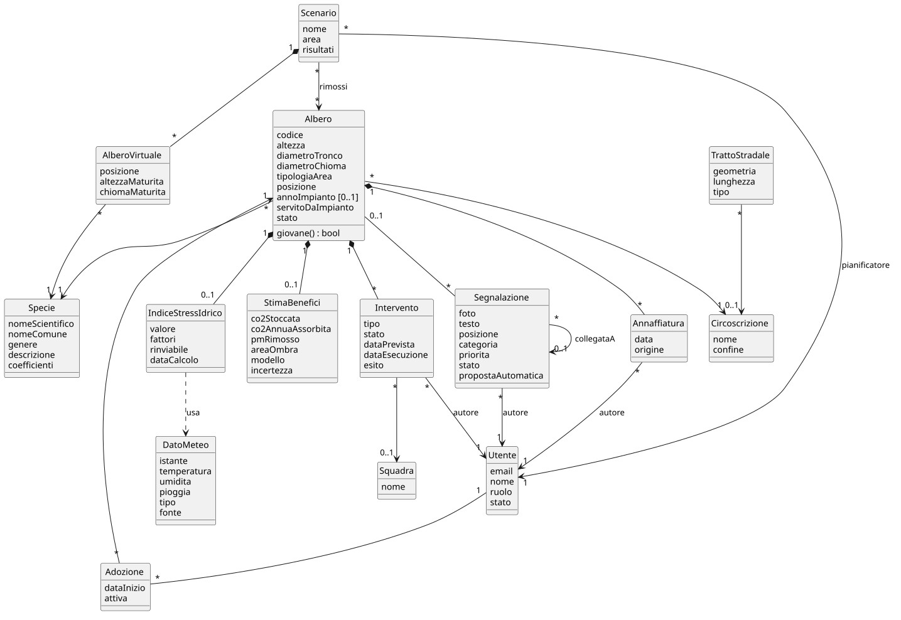
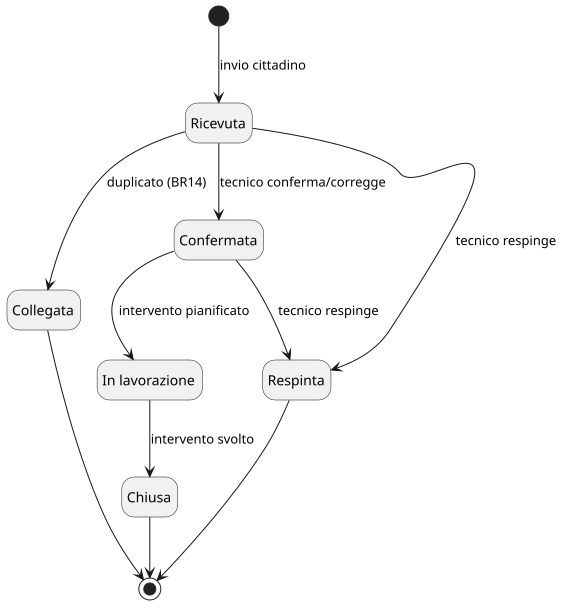
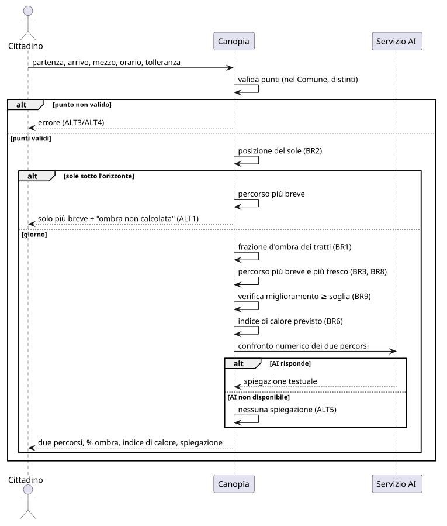
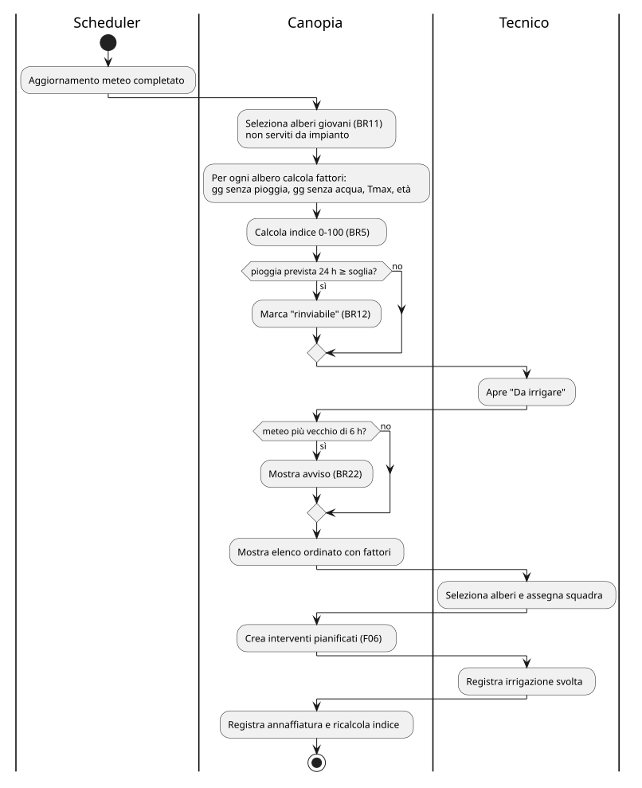

# D2 – AI-Ready Software Specification

**Progetto:** Canopia – gemello digitale della copertura arborea di Trento: benefici ecosistemici, irrigazione mirata e percorsi all'ombra
**Corso:** Ingegneria del Software, A.A. 2026-27 – Prof. Paolo Giorgini
**Gruppo:** [Nome 1 (team leader)], [Nome 2], [Nome 3]
**Versione:** 0.1 (bozza) – 02/11/2026

---

| Document Info | |
|---|---|
| Doc. Name | D2-CanopiaSpecification |
| Doc. Number | D2 V0.1 |
| Description | Specifica delle feature derivata dal D1: modelli (classi, attività, sequenza, stati), scenari, business rule, acceptance criteria verificabili, traceability verso D1 e D3 |
| Input | D1 V0.3 |

> Bozza di lavoro. Le parti tra `[ ]` sono da completare o validare con il Comune.

## Note D2

- **Ruolo del documento.** Il D2 trasforma i requisiti del D1 in specifiche di feature non ambigue e verificabili, abbastanza precise da essere date in input a un AI coding agent (Spec-Driven Development) e da derivarne i test. Descrive *che cosa* deve accadere e *come si verifica*, non *come si implementa*: architettura, API e tecnologie sono nel D3.
- **Identificatori.** Ogni feature ha un ID stabile `Fxx`. Al suo interno: scenari alternativi `ALTn`, business rule `BRn` (globali, numerazione del D1 proseguita da BR8), acceptance criteria `AC-Fxx-yy` in forma *Dato / Quando / Allora*, open question che rimandano ai `GAPn` del D1.
- **Traceability.** Ogni `AC-Fxx-yy` dichiara gli AC-USxx-yy del D1 da cui deriva; nel D3 ogni AC diventa almeno un test `TEST-Fxx-yy`. Catena: RF → US/AC (D1) → F/AC (D2) → Task/API (D3) → Test.
- **Living document.** Le modifiche dopo la baseline sono tracciate su GitHub e riassunte nella sezione 6, come nel D1.

---

## 1. Elenco delle feature

Le feature sono state identificate dall'analisi congiunta di RF, Use Case, User Story, mockup e user flow del D1. Una feature raggruppa ciò che l'utente percepisce come un'unica capacità.

| ID | Feature | RF | UC | US | Mockup | Priorità | Sprint previsto |
|---|---|---|---|---|---|---|---|
| F01 | Percorso all'ombra | RF14–RF18 | UC-01 | US-01 | MU-Fig.1 | M | 2 |
| F02 | Scheda albero e benefici per albero | RF1, RF8, RF19 | UC-02 | US-08 | MU-Fig.4 | M | 1 |
| F03 | Benefici aggregati e report | RF9, RF13, RF20 | UC-06 | US-05 | MU-Fig.6 | M | 2 |
| F04 | Indice di stress idrico e priorità di irrigazione | RF5, RF6, RF22 | UC-04, UC-11 | US-02 | MU-Fig.2, MU-Fig.4 | M | 2 |
| F05 | Filtri e interrogazione in linguaggio naturale | RF2, RF7 | UC-10, UC-14 | US-04, US-10 | MU-Fig.2 | M (filtri) / S (NL) | 1 / 3 |
| F06 | Interventi e calendario squadre | RF3, RF4 | UC-12 | US-03, US-11 | MU-Fig.2 | M | 2 |
| F07 | Scenario what-if e aree candidate | RF10, RF11, RF12 | UC-07 | US-06, US-12 | MU-Fig.3 | M | 3 |
| F08 | Segnalazioni dei cittadini | RF21 | UC-03, UC-13 | US-07 | MU-Fig.2, MU-Fig.5 | S | 3 |
| F09 | Adozione di un albero | RF23 | UC-05 | US-09 | MU-Fig.4 | C | 4 |
| F10 | Account, autenticazione e ruoli | RF24, RF25 | UC-15, UC-16 | US-13, US-14 | MU-Fig.7 | M | 1 |
| F11 | Aggiornamento dei dati dalle fonti | RF26, RF27 | UC-09 | US-15 | — | M | 1 |

Sprint di riferimento (da confermare nel D3): Sprint 1 fondamenta (dati, account, mappa); Sprint 2 cuore del valore (ombra, irrigazione, interventi, benefici); Sprint 3 AI e pianificazione; Sprint 4 funzioni Could e rifinitura.

---

## 2. Modelli trasversali

### 2.1 Modello del dominio

Il diagramma delle classi descrive i concetti del dominio e le loro relazioni, indipendentemente dal database che verrà scelto nel D3.

Sorgente: [diagrammi/d2-domain-model.puml](diagrammi/d2-domain-model.puml)

| Concetto | Descrizione | Attributi principali |
|---|---|---|
| Albero | Albero del censimento comunale | codice, specie, genere, altezza, diametroTronco, diametroChioma, tipologiaArea, circoscrizione, posizione, annoImpianto?, giovane, servitoDaImpianto, stato (vivo/abbattuto) |
| Specie | Specie botanica con coefficienti per le stime | nomeScientifico, nomeComune, genere, descrizione, coefficienti allometrici |
| StimaBenefici | Benefici stimati di un albero in una data | co2Stoccata, co2AnnuaAssorbita, pmRimosso, areaOmbra, modello, incertezza |
| Intervento | Intervento svolto o pianificato su un albero | tipo, stato (pianificato/svolto/annullato), dataPrevista, dataEsecuzione, esito, autore, squadra |
| Annaffiatura | Annaffiatura registrata da tecnico o cittadino | data, autore, origine (tecnico/cittadino) |
| IndiceStressIdrico | Valore calcolato per un albero giovane | valore 0–100, fattori, rinviabile, dataCalcolo |
| Segnalazione | Segnalazione di un cittadino | foto, testo, posizione, categoria, priorità, stato, propostaAutomatica, collegataA? |
| Scenario | Scenario what-if del pianificatore | nome, area, alberiVirtuali, alberiRimossi, risultati |
| AlberoVirtuale | Albero aggiunto in uno scenario | specie, posizione, altezzaMaturità, chiomaMaturità |
| TrattoStradale | Tratto della rete pedonale/ciclabile | geometria, lunghezza, tipo (pedonale/ciclabile) |
| Circoscrizione | Area amministrativa | nome, confine |
| DatoMeteo | Osservazione o previsione | istante, temperatura, umidità, pioggia, tipo (osservazione/previsione), fonte |
| Utente | Persona registrata | email, nome, ruolo, stato (in attesa/attivo/disattivato) |
| Adozione | Legame cittadino–albero | dataInizio, attiva |
| Squadra | Squadra operativa | nome, membri |

### 2.2 Ciclo di vita di una segnalazione (State Machine)

Sorgente: [diagrammi/d2-state-segnalazione.puml](diagrammi/d2-state-segnalazione.puml)

Transizioni ammesse: `ricevuta → confermata` (tecnico conferma o corregge la proposta), `ricevuta → collegata` (duplicato), `confermata → in lavorazione` (intervento pianificato), `in lavorazione → chiusa`, `ricevuta | confermata → respinta` (con motivazione). Ogni altra transizione è rifiutata (BR13).

### 2.3 Ciclo di vita di un intervento

`pianificato → svolto` (con esito e data di esecuzione), `pianificato → annullato`. Un intervento `svolto` di tipo *abbattimento* porta l'albero nello stato `abbattuto` (BR15).

### 2.4 Business rule

Le BR1–BR7 sono definite nel D1 (sez. 11) e restano valide. Le seguenti sono introdotte dal D2 per rendere esplicite regole implicite; i valori tra `[ ]` vanno validati con il Comune.

| ID | Regola | Feature |
|---|---|---|
| BR8 | Il percorso fresco non può superare la lunghezza del percorso più breve × (1 + tolleranza); tolleranza ammessa 0–50 %, default 20 %. | F01 |
| BR9 | Il percorso fresco è proposto solo se migliora la percentuale d'ombra di almeno [10] punti rispetto al più breve. | F01 |
| BR10 | L'ombra si calcola solo quando l'elevazione del sole è > 0° (tra alba e tramonto). | F01, F07 |
| BR11 | Un albero è *giovane* se `annoImpianto` è noto e l'età è < [3] anni; se `annoImpianto` manca, se il diametro del tronco è ≤ [10] cm (GAP4). | F04, F09 |
| BR12 | Un albero è *rinviabile* se la pioggia prevista nelle 24 h successive è ≥ [5] mm. | F04 |
| BR13 | Le transizioni di stato della segnalazione sono solo quelle della sez. 2.2. | F08 |
| BR14 | Due segnalazioni sono duplicate se riguardano lo stesso albero, la stessa categoria e la prima non è `chiusa` né `respinta`. | F08 |
| BR15 | Un albero abbattuto non compare nella mappa pubblica ma conserva storico e interventi. | F02, F06 |
| BR16 | Ogni stima riporta modello, versione dei coefficienti e incertezza; senza coefficienti per la specie si usano quelli del genere, e senza genere la stima non è calcolata. | F02, F03 |
| BR17 | Un cittadino può registrare al massimo [1] annaffiatura per albero ogni [12] ore; le annaffiature dei cittadini contano come quelle dei tecnici nell'indice. | F04 |
| BR18 | Un cittadino può avere al massimo [5] adozioni attive; un albero può essere adottato da più cittadini. | F09 |
| BR19 | Deve esistere sempre almeno un utente con ruolo amministratore attivo. | F10 |
| BR20 | Una proposta del servizio AI non modifica mai dati senza conferma esplicita di un utente (RNF7). | F05, F08 |
| BR21 | Gli alberi virtuali di uno scenario sono visibili solo nello scenario e al pianificatore che lo ha creato [o a tutti i pianificatori? GAP]. | F07 |
| BR22 | Se l'ultimo aggiornamento meteo riuscito è più vecchio di [6] ore, i dati dipendenti (indice, indice di calore) sono mostrati con un avviso. | F04, F11 |

---

## 3. Feature Specification

Formato per ogni feature (template del corso): elementi del D1 collegati, obiettivo, attori, precondizioni, scenario principale, scenari alternativi, business rule, dati e stati, acceptance criteria, requisiti non funzionali, GAP.

### F01 – Percorso all'ombra

**Riferimenti D1:** RF14, RF15, RF16, RF17, RF18 · UC-01 · US-01 (AC-US01-01…06) · MU-Fig.1 · User Flow cittadino · RNF1, RNF2, RNF3, RNF9 · BR1, BR2, BR3, BR6.

**Obiettivo.** Consentire a chiunque di confrontare, per un orario, il percorso più breve e il percorso più fresco tra due punti del Comune, a piedi o in bici.

**Attori.** Cittadino (anche non registrato). Servizio AI (secondario, solo spiegazione).

**Precondizioni.** Rete pedonale/ciclabile e censimento caricati; partenza e arrivo nel territorio comunale.

**Scenario principale.**
1. L'utente indica partenza, arrivo, mezzo, orario di partenza (default: ora) e tolleranza (default 20 %).
2. Il sistema calcola posizione del sole e frazione d'ombra dei tratti per l'orario (BR1, BR2).
3. Il sistema calcola il percorso più breve e il percorso più fresco entro la tolleranza (BR3, BR8).
4. Il sistema mostra per entrambi lunghezza, tempo stimato, percentuale all'ombra e l'indice di calore previsto (BR6).
5. Il sistema mostra una spiegazione testuale del confronto e i punti utili lungo il percorso fresco.

**Scenari alternativi / edge case.**
| ID | Caso | Comportamento |
|---|---|---|
| ALT1 | Orario con sole sotto l'orizzonte | Solo percorso più breve, messaggio "ombra non calcolata di notte" (BR10) |
| ALT2 | Miglioramento d'ombra < soglia | Solo percorso più breve, messaggio esplicativo (BR9) |
| ALT3 | Punto fuori dal Comune o non raggiungibile dalla rete | Errore con indicazione del punto da correggere |
| ALT4 | Partenza = arrivo | Errore "partenza e arrivo coincidono" |
| ALT5 | Servizio AI non disponibile | Risultato completo senza spiegazione (RNF6) |
| ALT6 | Dati meteo non aggiornati | Indice di calore mostrato con avviso (BR22) |

**Dati / stati.** TrattoStradale, Albero (altezza, chioma, posizione), DatoMeteo (previsione). Nessun dato del percorso viene salvato (RNF9).

**Acceptance criteria.**
| ID | Dato | Quando | Allora | Da D1 |
|---|---|---|---|---|
| AC-F01-01 | partenza e arrivo validi nel Comune, ore 14 di un giorno estivo | l'utente chiede il percorso | il sistema restituisce due percorsi, ciascuno con lunghezza (m), tempo (min) e percentuale all'ombra (0–100) | AC-US01-01 |
| AC-F01-02 | tolleranza 20 % e percorso breve di 1.600 m | il sistema calcola il percorso fresco | la sua lunghezza è ≤ 1.920 m | AC-US01-02 |
| AC-F01-03 | nessun percorso migliora l'ombra di almeno [10] punti | l'utente chiede il percorso | il sistema restituisce solo il più breve e un messaggio esplicativo | AC-US01-03 |
| AC-F01-04 | orario 23:00 | l'utente chiede il percorso | ombra non calcolata, solo percorso più breve, messaggio | AC-US01-04 |
| AC-F01-05 | indice di calore previsto sopra soglia [GAP5] | l'utente chiede il percorso | l'indice è mostrato e il percorso fresco è marcato come suggerito | AC-US01-05 |
| AC-F01-06 | un tratto lungo 100 m coperto da proiezioni di chioma per 40 m | il sistema calcola l'ombra | la frazione d'ombra del tratto è 0,40 (±0,02) | BR1 |
| AC-F01-07 | punto di arrivo fuori dal confine comunale | l'utente chiede il percorso | errore 'fuori dal territorio' e nessun percorso | UC-01 ecc. 1 |
| AC-F01-08 | servizio AI non raggiungibile | l'utente chiede il percorso | i due percorsi sono restituiti senza spiegazione e senza errore | RNF6 |
| AC-F01-09 | un percorso calcolato | la richiesta è completata | origine e destinazione non risultano in alcun archivio o log applicativo | RNF9 |

**RNF applicabili.** RNF3 (≤ [3] s per percorsi ≤ 5 km, 95° percentile), RNF2 (smartphone 360 px), RNF9, RNF10 (percorsi distinguibili anche senza colore: tratteggio/continuo).

**Modelli di dettaglio.** Sequence diagram: [diagrammi/d2-seq-f01-percorso.puml](diagrammi/d2-seq-f01-percorso.puml)

**GAP / open question.** Soglia dell'indice di calore (GAP5); fontane e panchine (GAP6); ombra degli edifici esclusa (GAP7); velocità di riferimento a piedi/bici [4,5 km/h e 15 km/h?].

---

### F02 – Scheda albero e benefici per albero

**Riferimenti D1:** RF1, RF8, RF19 · UC-02 · US-08 (AC-US08-01) · MU-Fig.4 · RNF5 · BR4, BR15, BR16 · GAP3, GAP10.

**Obiettivo.** Mostrare sulla mappa gli alberi censiti e, per ciascuno, una scheda con dati e benefici stimati comprensibili.

**Attori.** Cittadino, Tecnico, Pianificatore.

**Precondizioni.** Censimento importato (F11); coefficienti disponibili per la specie o il genere.

**Scenario principale.**
1. L'utente apre la mappa; il sistema mostra gli alberi vivi dell'area visibile.
2. L'utente seleziona un albero.
3. Il sistema mostra specie (comune e scientifica), dimensioni, tipologia di area, circoscrizione, descrizione della specie.
4. Il sistema mostra CO₂ stoccata e assorbita all'anno, PM rimosso all'anno, area d'ombra, con etichetta "stima", modello e incertezza, e un paragone comprensibile.
5. Se l'utente è un tecnico, la scheda mostra anche storico interventi e indice di stress idrico.

**Scenari alternativi.**
| ID | Caso | Comportamento |
|---|---|---|
| ALT1 | Dimensioni mancanti | Campi disponibili mostrati; benefici "non stimabili" (BR16) |
| ALT2 | Albero abbattuto | Non visibile al pubblico; visibile al tecnico con stato `abbattuto` (BR15) |
| ALT3 | Codice albero inesistente | Messaggio "albero non trovato" |

**Dati / stati.** Albero, Specie, StimaBenefici. Stato albero: `vivo`, `abbattuto`.

**Acceptance criteria.**
| ID | Dato | Quando | Allora | Da D1 |
|---|---|---|---|---|
| AC-F02-01 | un albero vivo con specie e dimensioni | l'utente lo seleziona | la scheda mostra specie, altezza, diametri, tipologia area e circoscrizione | RF1 |
| AC-F02-02 | lo stesso albero | la scheda è mostrata | i quattro benefici sono presenti con etichetta "stima", nome del modello e incertezza | AC-US08-01, RNF5 |
| AC-F02-03 | un albero senza diametro del tronco | la scheda è mostrata | i benefici risultano "non stimabili" e gli altri campi sono visibili | BR16 |
| AC-F02-04 | un albero abbattuto | un utente non tecnico consulta la mappa o la scheda | l'albero non è visibile | AC-US03-02 |
| AC-F02-05 | due alberi della stessa specie con diametro diverso | il sistema stima la CO₂ stoccata | l'albero con diametro maggiore ha stima maggiore | BR4 |
| AC-F02-06 | un'area visibile con 2.000 alberi | la mappa è caricata | tutti gli alberi dell'area sono rappresentati (anche aggregati a bassi livelli di zoom) entro [2] s | RNF3 |

**RNF applicabili.** RNF5, RNF10, RNF11 (attribuzione Comune di Trento).

**GAP.** Coefficienti allometrici (GAP3); fattore del paragone comprensibile (GAP10); licenza del censimento (GAP1).

---

### F03 – Benefici aggregati e report

**Riferimenti D1:** RF9, RF13, RF20 · UC-06 · US-05 (AC-US05-01…02), US-06 (AC-US06-05) · MU-Fig.6 · RNF5.

**Obiettivo.** Rendere disponibili i benefici aggregati per circoscrizione e città, confrontabili tra periodi ed esportabili.

**Attori.** Pianificatore (completo), Cittadino (solo consultazione del quartiere).

**Precondizioni.** Stime per albero calcolate; almeno un'istantanea annuale salvata per il confronto.

**Scenario principale.**
1. L'utente sceglie un'area (circoscrizione o città).
2. Il sistema mostra numero di alberi, copertura di chioma (%), CO₂ stoccata, CO₂ assorbita/anno, PM rimosso/anno.
3. Il pianificatore sceglie due periodi; il sistema mostra valori e differenze.
4. Il pianificatore esporta il report (PDF e CSV) con valori, modello, data e una sintesi testuale.

**Scenari alternativi.**
| ID | Caso | Comportamento |
|---|---|---|
| ALT1 | Periodo senza istantanea | Messaggio "dati non disponibili per il periodo" |
| ALT2 | Servizio AI non disponibile | Report senza sintesi testuale |
| ALT3 | Cittadino tenta l'export | Funzione non disponibile per il ruolo |

**Dati / stati.** StimaBenefici aggregata, istantanea annuale (snapshot per area e anno).

**Acceptance criteria.**
| ID | Dato | Quando | Allora | Da D1 |
|---|---|---|---|---|
| AC-F03-01 | una circoscrizione con alberi stimati | l'utente la seleziona | vede i 5 indicatori, ciascuno etichettato come stima | AC-US05-01, AC-US05-02 |
| AC-F03-02 | gli alberi di una circoscrizione | il sistema aggrega la CO₂ | il totale coincide con la somma delle stime dei singoli alberi vivi (±0,1 %) | RF9 |
| AC-F03-03 | istantanee 2025 e 2026 | il pianificatore confronta i periodi | per ogni indicatore vede valore 2025, 2026 e differenza | RF9 |
| AC-F03-04 | un pianificatore autenticato | chiede l'export CSV | riceve un file con una riga per indicatore, unità di misura e nome del modello | AC-US06-05 |
| AC-F03-05 | un cittadino | chiede l'export | la richiesta è rifiutata (403) | RNF8 |

**RNF applicabili.** RNF5, RNF8, RNF10 (mappa con valori numerici, non solo colore).

---

### F04 – Indice di stress idrico e priorità di irrigazione

**Riferimenti D1:** RF5, RF6, RF22 · UC-04, UC-11 · US-02 (AC-US02-01…03) · MU-Fig.2, MU-Fig.4 · RNF4 · BR5 · GAP4, GAP12.

**Obiettivo.** Calcolare per gli alberi giovani un indice di stress idrico spiegabile e ordinare le priorità di irrigazione dei giorni successivi.

**Attori.** Tecnico del verde (principale), Cittadino registrato (annaffiature), Scheduler (ricalcolo).

**Precondizioni.** Dati meteo aggiornati (F11); albero classificato giovane (BR11) e non servito da impianto.

**Scenario principale.**
1. Lo Scheduler, dopo ogni aggiornamento meteo, ricalcola l'indice degli alberi giovani (BR5).
2. Il tecnico apre "Da irrigare" e sceglie l'orizzonte (oggi / 3 giorni) e opzionalmente una circoscrizione.
3. Il sistema mostra l'elenco ordinato per indice decrescente con i fattori (giorni senza pioggia, giorni senza acqua, Tmax, età) e il flag *rinviabile* (BR12).
4. Il tecnico seleziona alberi e li assegna a una squadra (crea interventi pianificati, F06).
5. Quando un'annaffiatura è registrata (tecnico o cittadino), l'indice dell'albero si aggiorna subito.

**Scenari alternativi.**
| ID | Caso | Comportamento |
|---|---|---|
| ALT1 | Meteo non aggiornato da oltre [6] h | Elenco con avviso e data ultimo aggiornamento (BR22) |
| ALT2 | Cittadino annaffia un albero non giovane | Annaffiatura non registrata, messaggio "non necessaria" |
| ALT3 | Seconda annaffiatura dello stesso cittadino entro [12] h | Rifiutata (BR17) |
| ALT4 | Albero servito da impianto | Escluso dall'elenco (BR5, GAP12) |

**Dati / stati.** IndiceStressIdrico, Annaffiatura, DatoMeteo.

**Formula di riferimento (versione 0, da validare).**
`indice = min(100, 4·gg_senza_pioggia + 3·gg_senza_acqua + 2·max(0, Tmax − 25) ) × fattore_età`, con `fattore_età` = 1,0 al 1° anno, 0,8 al 2°, 0,6 al 3°. Pioggia significativa: ≥ [5] mm/giorno. I pesi sono parametri configurabili (non costanti nel codice).

**Acceptance criteria.**
| ID | Dato | Quando | Allora | Da D1 |
|---|---|---|---|---|
| AC-F04-01 | tre alberi giovani con indici 80, 40, 65 | il tecnico apre l'elenco | l'ordine è 80, 65, 40 e ogni riga mostra i fattori | AC-US02-01 |
| AC-F04-02 | un albero con 10 giorni senza acqua | un cittadino registra un'annaffiatura | i giorni senza acqua diventano 0 e l'indice è ricalcolato | AC-US02-02 |
| AC-F04-03 | pioggia prevista 8 mm nelle prossime 24 h | l'elenco è calcolato | gli alberi interessati sono marcati *rinviabile* | AC-US02-03 |
| AC-F04-04 | 12 gg senza pioggia, 10 gg senza acqua, Tmax 33 °C, 1° anno | il sistema calcola l'indice | il valore è 100 (saturato) | BR5 |
| AC-F04-05 | un albero con tronco 30 cm e anno di impianto ignoto | il sistema seleziona gli alberi giovani | l'albero non compare nell'elenco | BR11 |
| AC-F04-06 | un cittadino che ha annaffiato lo stesso albero 2 ore fa | registra un'altra annaffiatura | la richiesta è rifiutata con messaggio | BR17 |

**RNF applicabili.** RNF4, RNF5 (indice etichettato come stima), RNF10 (priorità con numero e testo, non solo colore).

**Modelli di dettaglio.** Activity diagram: [diagrammi/d2-activity-f04-irrigazione.puml](diagrammi/d2-activity-f04-irrigazione.puml)

**GAP.** Pesi e soglie da validare con un agronomo (GAP4); elenco alberi serviti da impianti (GAP12).

---

### F05 – Filtri e interrogazione in linguaggio naturale

**Riferimenti D1:** RF2, RF7 · UC-10, UC-14 · US-04 (AC-US04-01…02), US-10 (AC-US10-01…04) · MU-Fig.2 · RNF6, RNF7 · BR20.

**Obiettivo.** Permettere al tecnico di individuare gli alberi con filtri combinati o con una domanda in linguaggio naturale tradotta in filtri confermabili.

**Attori.** Tecnico del verde. Servizio AI (secondario).

**Precondizioni.** Tecnico autenticato.

**Scenario principale (filtri).**
1. Il tecnico imposta uno o più criteri: specie/genere, altezza min–max, diametro min–max, anno impianto, circoscrizione, tipologia area, stato, giorni senza acqua.
2. Il sistema restituisce gli alberi che soddisfano **tutti** i criteri impostati, con il loro numero, su mappa ed elenco paginato.

**Scenario principale (linguaggio naturale).**
1. Il tecnico scrive la domanda.
2. Il sistema invia la domanda al servizio AI chiedendo **solo** un oggetto filtro nel formato dei criteri ammessi (nessun accesso diretto ai dati).
3. Il sistema valida l'oggetto, mostra i filtri come chip modificabili ed evidenzia i termini non riconosciuti.
4. Dopo la conferma esegue la ricerca come nello scenario a filtri.

**Scenari alternativi.**
| ID | Caso | Comportamento |
|---|---|---|
| ALT1 | Nessun risultato | Messaggio informativo |
| ALT2 | Termine non riconosciuto (es. specie inesistente) | Segnalato all'utente, non ignorato |
| ALT3 | Il servizio AI restituisce un campo non ammesso | Campo scartato e segnalato |
| ALT4 | Servizio AI non disponibile o timeout [5] s | Messaggio e passaggio ai filtri manuali |

**Acceptance criteria.**
| ID | Dato | Quando | Allora | Da D1 |
|---|---|---|---|---|
| AC-F05-01 | filtri genere=Acer e circoscrizione=Centro storico | il tecnico esegue la ricerca | tutti i risultati soddisfano entrambi i criteri e il conteggio è mostrato | AC-US10-01 |
| AC-F05-02 | solo il filtro circoscrizione impostato | il tecnico esegue la ricerca | gli altri criteri non restringono il risultato | AC-US10-02 |
| AC-F05-03 | criteri senza corrispondenze | il tecnico esegue la ricerca | lista vuota e messaggio informativo | AC-US10-04 |
| AC-F05-04 | la domanda "aceri piantati da meno di 3 anni in centro" | il tecnico la invia | il sistema mostra i filtri interpretati e non esegue la ricerca prima della conferma | AC-US04-01, BR20 |
| AC-F05-05 | la domanda contiene "baobab" | il sistema la interpreta | "baobab" è segnalato come specie non riconosciuta | AC-US04-02 |
| AC-F05-06 | il servizio AI non risponde entro [5] s | il tecnico invia una domanda | messaggio e filtri manuali disponibili | RNF6 |
| AC-F05-07 | l'AI restituisce un campo `cancella: true` | il sistema valida la risposta | il campo è scartato; nessun dato viene modificato | BR20 |

**RNF applicabili.** RNF6, RNF7, RNF8 (solo ruolo tecnico), RNF3.

**GAP.** Fornitore e costi del servizio AI [da decidere nel D3].

---

### F06 – Interventi e calendario squadre

**Riferimenti D1:** RF3, RF4 · UC-12 · US-03 (AC-US03-01…02), US-11 (AC-US11-01…03) · MU-Fig.2 · BR15.

**Obiettivo.** Registrare gli interventi svolti e pianificare quelli futuri per squadra.

**Attori.** Tecnico del verde.

**Precondizioni.** Tecnico autenticato; albero esistente (tranne nuova piantumazione).

**Scenario principale.**
1. Il tecnico seleziona un albero e sceglie "nuovo intervento".
2. Indica tipo (potatura, controllo fitosanitario, irrigazione, abbattimento, nuova piantumazione), e se *pianificato* data prevista e squadra, se *svolto* data ed esito.
3. Il sistema salva l'intervento con autore e lo mostra nello storico o nel calendario.
4. Il tecnico segna un intervento pianificato come svolto; il sistema lo sposta nello storico.

**Scenari alternativi.**
| ID | Caso | Comportamento |
|---|---|---|
| ALT1 | Campi obbligatori mancanti | Salvataggio rifiutato con indicazione dei campi |
| ALT2 | Abbattimento svolto | Albero → `abbattuto` (BR15) |
| ALT3 | Nuova piantumazione | Crea un nuovo albero (posizione, specie, anno impianto = anno corrente) e l'intervento |
| ALT4 | Intervento di irrigazione svolto | Registra anche un'Annaffiatura (F04) |
| ALT5 | Data di esecuzione nel futuro | Rifiutata |

**Acceptance criteria.**
| ID | Dato | Quando | Allora | Da D1 |
|---|---|---|---|---|
| AC-F06-01 | un intervento di potatura svolto | il tecnico lo salva | compare nella scheda con data, tipo, esito e autore | AC-US03-01 |
| AC-F06-02 | un abbattimento svolto | il tecnico lo salva | l'albero non è più visibile al pubblico ma lo storico resta consultabile dal tecnico | AC-US03-02 |
| AC-F06-03 | un intervento pianificato senza squadra | il tecnico lo salva | salvataggio rifiutato | AC-US11-01 |
| AC-F06-04 | 3 interventi pianificati per la squadra A e 2 per la B | il tecnico filtra per squadra A | vede solo i 3 della squadra A | AC-US11-02 |
| AC-F06-05 | un intervento pianificato | il tecnico lo segna come svolto | esce dal calendario ed entra nello storico | AC-US11-03 |
| AC-F06-06 | un intervento di irrigazione svolto | è salvato | l'indice di stress idrico dell'albero viene ricalcolato | F04, ALT4 |

**RNF applicabili.** RNF8, RNF1.

---

### F07 – Scenario what-if e aree candidate

**Riferimenti D1:** RF10, RF11, RF12 · UC-07 · US-06 (AC-US06-01…04), US-12 (AC-US12-01…03) · MU-Fig.3 · RNF3 · BR1, BR4, BR7 · GAP8.

**Obiettivo.** Simulare l'effetto di nuove piantumazioni o rimozioni su ombra e benefici, e indicare le aree dove piantare.

**Attori.** Pianificatore. Servizio AI (sintesi).

**Precondizioni.** Pianificatore autenticato; mappa di calore disponibile (da Landsat in attesa di GAP8).

**Scenario principale.**
1. Il pianificatore consulta i livelli calore, impermeabilità e copertura, oppure la classifica delle aree candidate.
2. Crea uno scenario su un'area, aggiunge alberi virtuali (specie, dimensione a maturità) o marca alberi come rimossi.
3. Il sistema calcola la percentuale d'ombra sui tratti dell'area alle 11, 14 e 17 del giorno estivo di riferimento [21 luglio], prima e dopo, e i benefici a maturità prima e dopo.
4. Il sistema mostra il confronto e una sintesi; il pianificatore salva lo scenario.

**Punteggio delle aree candidate (versione 0).** `punteggio = 0,35·calore + 0,25·impermeabilità + 0,25·(1 − ombra) + 0,15·passaggio_pedonale`, ciascun fattore normalizzato 0–1 sui tratti del Comune; pesi configurabili.

**Scenari alternativi.**
| ID | Caso | Comportamento |
|---|---|---|
| ALT1 | Albero virtuale fuori dal Comune | Rifiutato |
| ALT2 | Albero virtuale a meno di [3] m da un albero esistente | Avviso, l'utente può confermare |
| ALT3 | Scenario con più di [500] alberi virtuali | Rifiutato (limite prestazioni) |

**Acceptance criteria.**
| ID | Dato | Quando | Allora | Da D1 |
|---|---|---|---|---|
| AC-F07-01 | uno scenario con 30 alberi virtuali su una via | il sistema calcola | per 11, 14 e 17 sono mostrate ombra prima, dopo e differenza in punti percentuali | AC-US06-01 |
| AC-F07-02 | lo stesso scenario | il sistema calcola | sono mostrate le variazioni di CO₂ e PM a maturità | AC-US06-02 |
| AC-F07-03 | uno scenario salvato | si consulta il censimento | nessun albero virtuale vi compare e nessun albero reale risulta modificato | AC-US06-03, BR7 |
| AC-F07-04 | la classifica delle aree candidate | è mostrata | ogni area riporta punteggio e i 4 fattori | AC-US06-04 |
| AC-F07-05 | aggiunta di alberi su un tratto senza ombra | il sistema ricalcola | l'ombra "dopo" è ≥ dell'ombra "prima" su ogni tratto | BR1 |
| AC-F07-06 | i livelli della mappa | sono mostrati | ciascuno indica fonte, data e risoluzione | AC-US12-02 |
| AC-F07-07 | uno scenario di quartiere (≤ 200 alberi virtuali) | il pianificatore lo ricalcola | il risultato arriva entro [10] s | RNF3 |

**GAP.** Mappe di calore ufficiali (GAP8); visibilità degli scenari tra pianificatori (BR21).

---

### F08 – Segnalazioni dei cittadini

**Riferimenti D1:** RF21 · UC-03, UC-13 · US-07 (AC-US07-01…03) · MU-Fig.2, MU-Fig.5 · RNF6, RNF7, RNF9 · V6 · GAP11.

**Obiettivo.** Permettere ai cittadini registrati di segnalare problemi su un albero, con triage automatico proposto e conferma del tecnico.

**Attori.** Cittadino registrato, Tecnico. Secondari: Servizio AI, SensorTrento.

**Precondizioni.** Cittadino autenticato.

**Scenario principale.**
1. Il cittadino seleziona un albero o una posizione e allega foto (max [3], max [5] MB) e testo.
2. Il sistema oscura volti e targhe nella foto, poi chiede al servizio AI categoria, priorità e albero più probabile (entro [30] m).
3. Il sistema verifica i duplicati (BR14) e mostra la proposta; il cittadino può modificarla e invia.
4. La segnalazione è salvata come `ricevuta` e inoltrata a SensorTrento [GAP11].
5. Il tecnico conferma o corregge la proposta → `confermata`; poi la porta in lavorazione e la chiude (sez. 2.2).
6. Il cittadino vede ogni cambio di stato.

**Scenari alternativi.**
| ID | Caso | Comportamento |
|---|---|---|
| ALT1 | Duplicato | La nuova segnalazione è `collegata` alla prima |
| ALT2 | Servizio AI non disponibile | Inviata senza proposta, classificata dal tecnico |
| ALT3 | Il cittadino indica "pericolo immediato" | Mostra i numeri di emergenza (V6) e salva comunque con priorità alta |
| ALT4 | Foto in formato non ammesso o troppo grande | Rifiutata con messaggio |
| ALT5 | Nessun albero entro [30] m | Segnalazione legata alla sola posizione |
| ALT6 | Transizione di stato non ammessa | Rifiutata (BR13) |

**Acceptance criteria.**
| ID | Dato | Quando | Allora | Da D1 |
|---|---|---|---|---|
| AC-F08-01 | foto e testo validi | il cittadino invia | la segnalazione ha stato `ricevuta`, proposta di categoria, priorità e albero | AC-US07-01 |
| AC-F08-02 | una segnalazione aperta su albero X, categoria "ramo pericolante" | un altro cittadino segnala X con la stessa categoria | la nuova è `collegata` alla prima | AC-US07-02 |
| AC-F08-03 | una segnalazione `ricevuta` con proposta | il tecnico cambia la categoria e conferma | categoria corretta salvata, stato `confermata`, il cittadino vede il nuovo stato | AC-US07-03 |
| AC-F08-04 | una segnalazione `chiusa` | il tecnico tenta di riportarla a `ricevuta` | operazione rifiutata | BR13 |
| AC-F08-05 | servizio AI non disponibile | il cittadino invia | la segnalazione è salvata senza proposta | RNF6 |
| AC-F08-06 | una foto con un volto riconoscibile | viene salvata | l'immagine pubblicata ha il volto oscurato | RNF9 |
| AC-F08-07 | una segnalazione con proposta AI | nessun tecnico l'ha confermata | categoria e priorità risultano "proposte" e non ufficiali | RNF7 |

**GAP.** API SensorTrento (GAP11); servizio di oscuramento volti/targhe [D3]; conservazione delle foto [periodo, GDPR].

---

### F09 – Adozione di un albero

**Riferimenti D1:** RF23 · UC-05 · US-09 (AC-US09-01) · MU-Fig.4 · GAP9.

**Obiettivo.** Permettere al cittadino di adottare un albero giovane e ricevere un avviso quando ha bisogno d'acqua.

**Attori.** Cittadino registrato. Scheduler.

**Precondizioni.** Cittadino autenticato; albero giovane (BR11).

**Scenario principale.**
1. Dalla scheda il cittadino sceglie "Adotta".
2. Il sistema registra l'adozione (BR18).
3. Dopo ogni ricalcolo dell'indice, se un albero adottato supera la soglia [70], il sistema invia un avviso all'adottante (al massimo uno ogni [24] h per albero).
4. Il cittadino può rinunciare all'adozione.

**Acceptance criteria.**
| ID | Dato | Quando | Allora | Da D1 |
|---|---|---|---|---|
| AC-F09-01 | un albero adottato con indice che passa da 60 a 75 | l'indice è ricalcolato | l'adottante riceve un avviso | AC-US09-01 |
| AC-F09-02 | un avviso inviato 3 ore fa | l'indice è ancora sopra soglia | nessun nuovo avviso | F09 passo 3 |
| AC-F09-03 | un cittadino con 5 adozioni attive | adotta un sesto albero | richiesta rifiutata | BR18 |
| AC-F09-04 | un'adozione annullata | l'indice supera la soglia | nessun avviso | UC-05 ecc. 1 |

**GAP.** Canale di notifica (GAP9): nel MVP avviso in-app; email da decidere.

---

### F10 – Account, autenticazione e ruoli

**Riferimenti D1:** RF24, RF25 · UC-15, UC-16 · US-13 (AC-US13-01…05), US-14 (AC-US14-01…03) · MU-Fig.7 · RNF8, RNF9 · BR19.

**Obiettivo.** Gestire registrazione, accesso e autorizzazioni per ruolo.

**Attori.** Cittadino, Tecnico, Pianificatore, Amministratore.

**Matrice dei permessi.**
| Funzione | Anonimo | Cittadino reg. | Tecnico | Pianificatore | Admin |
|---|---|---|---|---|---|
| Mappa, scheda, percorso, benefici quartiere (F01, F02, F03 lettura) | ✓ | ✓ | ✓ | ✓ | ✓ |
| Segnalare, annaffiare, adottare (F04, F08, F09) | — | ✓ | ✓ | — | — |
| Filtri, NL, irrigazione, interventi, gestione segnalazioni (F04–F06, F08) | — | — | ✓ | — | — |
| Scenari, mappa calore, export (F03, F07) | — | — | — | ✓ | — |
| Utenti e ruoli (F10) | — | — | — | — | ✓ |

**Scenario principale.** Come UC-16 e UC-15 del D1.

**Acceptance criteria.**
| ID | Dato | Quando | Allora | Da D1 |
|---|---|---|---|---|
| AC-F10-01 | dati di registrazione completi | la persona si registra | il profilo è `in attesa` e viene inviata un'email di conferma | AC-US13-01 |
| AC-F10-02 | un profilo `in attesa` | l'utente apre il link valido | il profilo diventa `attivo` | AC-US13-01 |
| AC-F10-03 | un'email già registrata | una persona si registra con la stessa email | registrazione rifiutata | AC-US13-02 |
| AC-F10-04 | credenziali errate | l'utente tenta l'accesso | messaggio generico, senza indicare il campo errato | AC-US13-04 |
| AC-F10-05 | un cittadino autenticato | chiama una funzione del tecnico | richiesta rifiutata (403) | RNF8, AC-US14-02 |
| AC-F10-06 | un utente anonimo | chiede un percorso o una scheda | la richiesta è servita | AC-US13-05 |
| AC-F10-07 | un solo amministratore attivo | revoca il proprio ruolo | operazione rifiutata | AC-US14-03, BR19 |
| AC-F10-08 | un tecnico a cui è stato revocato il ruolo | usa una sessione ottenuta prima | dalla scadenza del token non accede più alle funzioni del tecnico [entro 24 h; GAP: revoca immediata?] | AC-US14-02 |

**RNF applicabili.** RNF8, RNF9 (password mai conservate in chiaro).

---

### F11 – Aggiornamento dei dati dalle fonti

**Riferimenti D1:** RF26, RF27 · UC-09 · US-15 (AC-US15-01…04) · RNF4, RNF11 · BR22 · GAP1, GAP2.

**Obiettivo.** Mantenere aggiornati censimento, cartografia e meteo e ricalcolare gli indici dipendenti.

**Attori.** Scheduler. Fonti dati. Amministratore (avvio manuale).

**Scenario principale.**
1. Lo Scheduler avvia l'aggiornamento meteo ogni [3] h e quello del censimento ogni [settimana] o su richiesta dell'amministratore.
2. Il sistema acquisisce i dati, li valida (schema, coordinate nel Comune, valori fisicamente plausibili) e li salva.
3. Il sistema ricalcola indice di stress idrico (dopo meteo) e benefici (dopo censimento) e registra l'esito.

**Scenari alternativi.**
| ID | Caso | Comportamento |
|---|---|---|
| ALT1 | Fonte non raggiungibile | Dati precedenti mantenuti, errore registrato, nuovo tentativo dopo [15] min (max 3) |
| ALT2 | Record non valido | Scartato e conteggiato nel log dell'importazione |
| ALT3 | Albero presente prima e assente ora nel censimento | Marcato `non più nel censimento`, non cancellato |

**Acceptance criteria.**
| ID | Dato | Quando | Allora | Da D1 |
|---|---|---|---|---|
| AC-F11-01 | ultimo aggiornamento meteo 3 h fa | lo Scheduler esegue | nuove previsioni salvate con istante e fonte | AC-US15-01 |
| AC-F11-02 | nuove previsioni salvate | l'aggiornamento termina | l'indice di stress idrico degli alberi giovani è ricalcolato | AC-US15-02 |
| AC-F11-03 | fonte meteo che risponde con errore | lo Scheduler esegue | i dati precedenti restano e la data dell'ultimo aggiornamento riuscito non cambia | AC-US15-03 |
| AC-F11-04 | un record con coordinate fuori dal Comune | il censimento è importato | il record è scartato e conteggiato | ALT2 |
| AC-F11-05 | dati importati | sono mostrati | riportano l'attribuzione della fonte | AC-US15-04, RNF11 |
| AC-F11-06 | un albero sparito dal nuovo censimento | l'importazione termina | l'albero resta nel sistema con stato `non più nel censimento` e il suo storico | ALT3 |

---

## 4. Specifiche per l'AI coding agent

Indicazioni valide per tutte le feature quando la specifica è data in input a un agente:
- **Fonte di verità:** gli AC del D2 e le BR; se il codice e una AC sono in conflitto, vale la AC finché non è registrata una modifica (sez. 6).
- **Parametri:** tutti i valori tra `[ ]` e i pesi delle formule sono parametri di configurazione con default documentato, mai costanti sparse nel codice.
- **Ruolo dell'AI nel prodotto:** il servizio AI riceve solo il testo o la foto necessari e restituisce un oggetto con schema fisso; l'output è sempre validato e mai applicato senza conferma (BR20). I calcoli (ombra, benefici, indice, punteggio, percorsi) sono deterministici e non usano il servizio AI.
- **Test prima del codice:** per ogni AC l'agente scrive prima il test `TEST-Fxx-yy` (D3), poi l'implementazione.
- **Dati personali:** nessun log di origine/destinazione dei percorsi, password solo come hash.

---

## 5. Traceability

### 5.1 D1 → D2
| RF | Feature | AC del D2 |
|---|---|---|
| RF1 | F02 | AC-F02-01, AC-F02-06 |
| RF2 | F05 | AC-F05-01…03 |
| RF3 | F06 | AC-F06-01, AC-F06-02 |
| RF4 | F06 | AC-F06-03…05 |
| RF5 | F04 | AC-F04-02, AC-F04-04, AC-F04-05 |
| RF6 | F04 | AC-F04-01, AC-F04-03 |
| RF7 | F05 | AC-F05-04…07 |
| RF8 | F02 | AC-F02-02, AC-F02-03, AC-F02-05 |
| RF9 | F03 | AC-F03-01…03 |
| RF10 | F07 | AC-F07-06 |
| RF11 | F07 | AC-F07-01…03, AC-F07-05, AC-F07-07 |
| RF12 | F07 | AC-F07-04 |
| RF13 | F03 | AC-F03-04, AC-F03-05 |
| RF14 | F01 | AC-F01-04, AC-F01-06 |
| RF15 | F01 | AC-F01-01, AC-F01-03, AC-F01-07 |
| RF16 | F01 | AC-F01-02 |
| RF17 | F01 | AC-F01-05 |
| RF18 | F01 | [AC da aggiungere quando GAP6 è chiuso] |
| RF19 | F02 | AC-F02-01…03 |
| RF20 | F03 | AC-F03-01 |
| RF21 | F08 | AC-F08-01…07 |
| RF22 | F04 | AC-F04-02, AC-F04-06 |
| RF23 | F09 | AC-F09-01…04 |
| RF24 | F10 | AC-F10-01…04, AC-F10-06 |
| RF25 | F10 | AC-F10-05, AC-F10-07, AC-F10-08 |
| RF26 | F11 | AC-F11-04…06 |
| RF27 | F11 | AC-F11-01…03 |

### 5.2 RNF → D2
| RNF | Verificato da |
|---|---|
| RNF1 | Test di usabilità (D3/D4) su MU-Fig.1 e F01 |
| RNF3 | AC-F02-06, AC-F07-07 + test di carico sul percorso (D3) |
| RNF4 | AC-F11-01, BR22 |
| RNF5 | AC-F02-02, AC-F03-01 |
| RNF6 | AC-F01-08, AC-F05-06, AC-F08-05 |
| RNF7 | AC-F05-04, AC-F05-07, AC-F08-07 |
| RNF8 | AC-F03-05, AC-F10-05 |
| RNF9 | AC-F01-09, AC-F08-06 |
| RNF11 | AC-F11-05 |

---

## 6. Gestione delle modifiche

| ID | Tipo | Descrizione | Origine | Artefatti impattati | GitHub / Stato |
|---|---|---|---|---|---|
| CH-01 | Clarification | Introdotte BR8–BR22 per rendere esplicite soglie e regole implicite nel D1 | Team (D2) | D1 sez. 11; D2; D3 test | [#issue — OPEN] |
