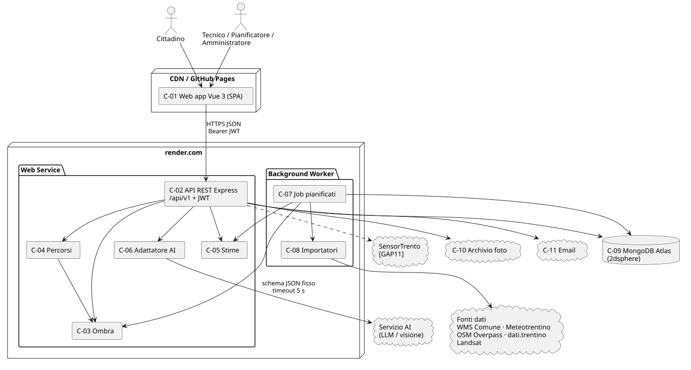

# D3 – Technical Plan, Tasks, Implementation & Testing

**Progetto:** Canopia – gemello digitale della copertura arborea di Trento: benefici ecosistemici, irrigazione mirata e percorsi all'ombra
**Corso:** Ingegneria del Software, A.A. 2026-27 – Prof. Paolo Giorgini
**Gruppo:** [Nome 1 (team leader)], [Nome 2], [Nome 3]
**Versione:** 0.1 (bozza) – 02/11/2026

---

| Document Info | |
|---|---|
| Doc. Name | D3-CanopiaTechnicalPlan |
| Doc. Number | D3 V0.1 |
| Description | Piano tecnico (architettura, dati, API), scomposizione in task e sprint, strategia di implementazione e di test, traceability da AC del D2 a test |
| Input | D1 V0.3, D2 V0.1 |

> Bozza di lavoro. Le parti tra `[ ]` sono da completare; la sezione 7 (stato dell'implementazione) si aggiorna a ogni sprint.

## Note D3

- **Ruolo del documento.** Il D3 decide *come* realizzare le feature del D2: architettura, tecnologie, modello dei dati, API, piano dei task, strategia di test. È il primo documento in cui compaiono scelte tecniche.
- **Identificatori.** Componenti `C-xx`, decisioni architetturali `ADR-xx`, task `T-xx`, test `TEST-Fxx-yy` (uno o più per ogni `AC-Fxx-yy` del D2), endpoint come `METODO /percorso`.
- **Catena di traceability.** RF (D1) → AC-USxx-yy (D1) → AC-Fxx-yy (D2) → T-xx / endpoint (D3) → TEST-Fxx-yy (D3) → esito (D4).
- **Spec-Driven Development.** Ogni task è eseguibile da un AI coding agent con in input: feature del D2, endpoint dell'OpenAPI, test da far passare. Il codice è accettato solo se i test collegati passano in CI.

---

## 1. Architettura

### 1.1 Vista d'insieme

Architettura a tre livelli secondo le indicazioni del laboratorio: Single-Page Application servita come contenuto statico, servizio REST stateless, database documentale con indici geospaziali; job pianificati separati dal servizio web.

Sorgente: [diagrammi/d3-architettura.puml](diagrammi/d3-architettura.puml)



| ID | Componente | Responsabilità | Tecnologia |
|---|---|---|---|
| C-01 | Web app cittadino e back-office | Interfaccia SPA responsive (mobile per cittadino, desktop per back-office), mappa, chiamate API | Vue 3 + Vite, Vue Router, Pinia, MapLibre GL JS |
| C-02 | API REST | Endpoint `/api/v1`, validazione, autenticazione e autorizzazione | Node.js 20 LTS, Express 4, express-openapi-validator |
| C-03 | Modulo ombra | Posizione del sole, proiezione delle chiome, frazione d'ombra per tratto (BR1, BR2, BR10) | suncalc, @turf/turf |
| C-04 | Modulo percorsi | Grafo della rete pedonale/ciclabile, cammino minimo con costo ombra (BR3, BR8, BR9) | ngraph.graph + ngraph.path (A*) |
| C-05 | Modulo stime | Benefici ecosistemici (BR4, BR16), indice di stress idrico (BR5, BR11, BR12), punteggio aree candidate | JavaScript puro, parametri in configurazione |
| C-06 | Adattatore AI | Unico punto di contatto con il servizio LLM/visione: prompt, schema di output, validazione, timeout, fallback (BR20, RNF6) | SDK del provider scelto (ADR-05), zod |
| C-07 | Job pianificati | Aggiornamento meteo, censimento, ricalcolo indici, avvisi adozioni (F09, F11) | node-cron in processo worker separato |
| C-08 | Importatori | Lettura e validazione delle fonti (WMS Comune, Meteotrentino/meteo.report, Overpass OSM, dati.trentino) | axios, script `scripts/` |
| C-09 | Database | Persistenza, query geospaziali | MongoDB Atlas (cluster M0/M10), Mongoose |
| C-10 | Archivio file | Foto delle segnalazioni oscurate | [Cloudinary o storage S3-compatibile – ADR-07] |
| C-11 | Email | Conferma registrazione | [Brevo/Resend piano gratuito – ADR-08] |

### 1.2 Decisioni architetturali

| ID | Decisione | Motivazione | Alternative scartate |
|---|---|---|---|
| ADR-01 | SPA Vue 3 servita come statico (GitHub Pages/CDN), nessun SSR | Indicazione del laboratorio; mappa interattiva lato client; costi nulli | SSR (Nuxt): complessità non necessaria |
| ADR-02 | REST stateless con JWT (scadenza 24 h) | Indicazione del laboratorio (stateless, bearer token); scala orizzontalmente | Sessioni server: non stateless |
| ADR-03 | MongoDB con indici `2dsphere` | Vincolo del corso (V1); query `$geoWithin`/`$near` native per alberi e tratti | PostGIS: più potente ma fuori dallo stack del corso |
| ADR-04 | Ombra e percorsi calcolati nel backend con grafo in memoria | ~18.000 alberi e ~[30.000] tratti stanno in memoria (< 200 MB); A* in memoria rispetta RNF3 | Servizio di routing esterno (OSRM/Valhalla): non supporta un costo d'ombra dinamico |
| ADR-05 | Servizio AI esterno dietro un adattatore con schema JSON fisso e timeout 5 s; modello piccolo per filtri e triage, multimodale per le foto | RNF6/RNF7: sostituibile, disattivabile; output sempre validato. Candidato: Claude (Anthropic) [modello e costi da confermare] | Modello locale: risorse non disponibili su piano gratuito |
| ADR-06 | Ombra pre-calcolata per fasce orarie (ogni 30 min) e giorno tipo per mese, ricalcolo on-demand solo per gli scenari | Riduce il tempo di risposta del percorso a una lettura (RNF3) | Calcolo completo a ogni richiesta: > 3 s |
| ADR-07 | Foto oscurate prima del salvataggio, originali mai salvati | RNF9 privacy by design | Oscuramento a posteriori |
| ADR-08 | Avvisi delle adozioni in-app nel MVP | GAP9 aperto; nessun costo di invio | Push/email: rinviati |
| ADR-09 | Parametri delle formule (pesi, soglie `[ ]` del D2) in `config/parametri.json` versionato | Le soglie andranno validate col Comune senza modificare il codice | Costanti nel codice |

### 1.3 Deploy

| Ambiente | Frontend | Backend | DB |
|---|---|---|---|
| Locale | `vite dev` | `node` + nodemon | MongoDB in Docker o `mongodb-memory-server` per i test |
| Sviluppo/demo | GitHub Pages | render.com Web Service (free) + Background Worker per C-07 | MongoDB Atlas M0 |
| Produzione (ipotesi per il Comune) | CDN | render.com o infrastruttura del Comune | Atlas M10 o istanza del Comune |

Segreti (`JWT_SECRET`, `MONGODB_URI`, chiave AI, chiave email) solo come variabili d'ambiente, mai nel repository.

---

## 2. Modello dei dati

Traduzione del modello del dominio del D2 (sez. 2.1) in collezioni MongoDB. Le relazioni 1–molti con molti elementi (interventi, annaffiature) sono collezioni separate con riferimento; quelle piccole e sempre lette insieme sono documenti incorporati.

| Collezione | Contenuto | Indici |
|---|---|---|
| `alberi` | codice, specieId, misure, tipologiaArea, circoscrizione, `posizione` (GeoJSON Point), annoImpianto, servitoDaImpianto, stato, `benefici` (incorporati), `stress` (incorporato: valore, fattori, rinviabile, calcolatoIl), ultimaAnnaffiatura | `codice` unico, `posizione` 2dsphere, `{circoscrizione, specieId}`, `stress.valore` |
| `specie` | nomeScientifico, nomeComune, genere, descrizione, coefficienti {versione, a, b, …} | `nomeScientifico` unico, `genere` |
| `interventi` | alberoId, tipo, stato, dataPrevista, dataEsecuzione, esito, squadra, autoreId | `{alberoId, dataEsecuzione}`, `{squadra, dataPrevista}` |
| `annaffiature` | alberoId, data, autoreId, origine | `{alberoId, data}`, `{autoreId, alberoId, data}` |
| `tratti` | geometria (LineString), lunghezza, tipo, circoscrizione, `ombra` {mese: {"HH:MM": frazione}} | `geometria` 2dsphere |
| `meteo` | istante, tipo, temperatura, umidita, pioggia, fonte, stazione | `{tipo, istante}` |
| `segnalazioni` | autoreId, testo, foto[], posizione, alberoId, categoria, priorita, proposta {categoria, priorita, alberoId, confidenza}, confermata, stato, collegataA, storicoStati[] | `posizione` 2dsphere, `{alberoId, categoria, stato}` |
| `scenari` | pianificatoreId, nome, area (Polygon), alberiVirtuali[], alberiRimossi[], risultati, creatoIl | `pianificatoreId` |
| `utenti` | email, hashPassword (bcrypt, costo 12), nome, cognome, ruolo, stato, tokenConferma | `email` unico |
| `adozioni` | utenteId, alberoId, dataInizio, attiva, ultimoAvviso | `{utenteId, attiva}`, `{alberoId, attiva}` |
| `notifiche` | utenteId, tipo, testo, letta, creataIl | `{utenteId, letta}` |
| `snapshotBenefici` | area, anno, indicatori, modelloVersione | `{area, anno}` unico |
| `importazioni` | fonte, inizio, fine, esito, letti, scartati, errori[] | `{fonte, inizio}` |
| `aree` | circoscrizioni e livelli raster aggregati (calore, impermeabilità, copertura) con fonte, data, risoluzione | `geometria` 2dsphere |

Nessuna collezione memorizza origine o destinazione dei percorsi (RNF9, AC-F01-09).

---

## 3. API

La specifica completa è in [api/openapi.yaml](../api/openapi.yaml) (OpenAPI 3.0, validata con Redocly). Ogni operazione dichiara `x-feature` e `x-ac` per la traceability. Convenzioni (dal laboratorio):
- base path `/api/v1`, risorse al plurale, JSON, link `self` nelle risorse;
- `GET` 200, `POST` 201 (202 se asincrono), `DELETE` 204, `PATCH`/`PUT` 200;
- errori: 400 dati non validi, 401 token mancante/non valido, 403 ruolo non autorizzato, 404 non trovato, 409 conflitto con una business rule, 503 servizio AI non disponibile;
- autenticazione: `POST /auth/login` → JWT nel body; poi `Authorization: Bearer <token>`; un middleware `autentica` verifica il token e un middleware `richiediRuolo(...ruoli)` applica la matrice dei permessi del D2 (F10).

| Endpoint | Ruolo | Feature |
|---|---|---|
| `POST /auth/register`, `POST /auth/confirm`, `POST /auth/login` | pubblico | F10 |
| `GET /alberi` (bbox pubblico, filtri avanzati tecnico) | pubblico / tecnico | F02, F05 |
| `POST /alberi/interroga` | tecnico | F05 |
| `GET /alberi/{codice}` | pubblico (+ dati tecnico) | F02 |
| `GET, POST /alberi/{codice}/interventi`, `GET /interventi`, `PATCH /interventi/{id}` | tecnico | F06 |
| `POST /alberi/{codice}/annaffiature` | cittadino reg., tecnico | F04 |
| `POST, DELETE /alberi/{codice}/adozioni`, `GET /notifiche` | cittadino reg. | F09 |
| `POST /percorsi` | pubblico | F01 |
| `GET /benefici` | pubblico | F03 |
| `GET /benefici/report` | pianificatore | F03 |
| `GET /irrigazione/priorita` | tecnico | F04 |
| `GET /mappe/livelli`, `GET /aree-candidate`, `GET, POST /scenari`, `GET, DELETE /scenari/{id}` | pianificatore | F07 |
| `GET, POST /segnalazioni` | cittadino reg. (proprie), tecnico (tutte) | F08 |
| `PATCH /segnalazioni/{id}` | tecnico | F08 |
| `GET, POST /utenti`, `PUT /utenti/{id}/ruolo` | amministratore | F10 |
| `GET, POST /dati/importazioni` | amministratore | F11 |

Limiti di uso: `express-rate-limit` su `/auth/*` (10 richieste/min per IP) e `/percorsi` (60/min per IP).

---

## 4. Struttura del repository

```
canopia/
├── backend/
│   ├── src/
│   │   ├── app.js              # Express, middleware, router
│   │   ├── server.js           # avvio HTTP
│   │   ├── worker.js           # job pianificati (C-07)
│   │   ├── config/parametri.json
│   │   ├── middleware/         # autentica, richiediRuolo, errori, validazione OpenAPI
│   │   ├── models/             # schemi Mongoose
│   │   ├── routes/             # un file per risorsa
│   │   ├── services/           # ombra, percorsi, stime, ai, segnalazioni, importatori
│   │   └── jobs/
│   └── test/
│       ├── unit/               # servizi puri (ombra, stime, BR)
│       ├── api/                # supertest + mongodb-memory-server
│       └── fixtures/           # dati di prova (quartiere campione)
├── frontend/
│   ├── src/ (views/, components/, stores/, api/)
│   └── test/                   # Vitest + Vue Test Utils
├── e2e/                        # Playwright: percorsi utente principali
├── api/openapi.yaml
├── docs/                       # D1–D4, diagrammi
└── .github/workflows/ci.yml
```

---

## 5. Piano dei task

Stima in story point (Fibonacci). Capacità ipotizzata: 3 persone × 2 settimane per sprint ≈ [20] SP per sprint. Ogni task è chiuso solo quando i test indicati passano in CI e il codice è stato rivisto da un altro membro (Pull Request).

### Sprint 1 – Fondamenta (dati, account, mappa) · [dal … al …]
| ID | Task | Feature | Test da far passare | SP | Assegnatario |
|---|---|---|---|---|---|
| T-01 | Setup repository, monorepo, lint, CI GitHub Actions, deploy render + Pages | — | pipeline verde | 3 | [ ] |
| T-02 | Schemi Mongoose e indici (sez. 2) | tutte | unit modelli | 2 | [ ] |
| T-03 | Importatore censimento + specie + circoscrizioni con validazione | F11 | TEST-F11-04, -05, -06 | 3 | [ ] |
| T-04 | Importatore meteo e job ogni 3 h | F11 | TEST-F11-01, -03 | 2 | [ ] |
| T-05 | Registrazione, conferma email, login JWT, middleware ruoli | F10 | TEST-F10-01…07 | 5 | [ ] |
| T-06 | `GET /alberi` (bbox + filtri) e `GET /alberi/{codice}` | F02, F05 | TEST-F02-01, -04, TEST-F05-01…03 | 3 | [ ] |
| T-07 | Frontend: shell, routing per ruolo, mappa alberi, scheda albero, login (MU-Fig.4, MU-Fig.7) | F02, F10 | e2e accesso + scheda | 5 | [ ] |
| | | | **Totale** | **23** | |

### Sprint 2 – Valore principale (ombra, percorsi, irrigazione, interventi, benefici)
| ID | Task | Feature | Test | SP | Assegnatario |
|---|---|---|---|---|---|
| T-08 | Modulo stime benefici per albero + paragone | F02 | TEST-F02-02, -03, -05 | 3 | [ ] |
| T-09 | Modulo ombra: sole, proiezione chiome, frazione per tratto, pre-calcolo (ADR-06) | F01 | TEST-F01-04, -06 | 5 | [ ] |
| T-10 | Importatore rete OSM e grafo; `POST /percorsi` breve/fresco, tolleranza, soglia | F01 | TEST-F01-01…03, -07, -09 | 5 | [ ] |
| T-11 | Frontend percorso all'ombra (MU-Fig.1) | F01 | e2e percorso | 3 | [ ] |
| T-12 | Indice di stress idrico, job di ricalcolo, `GET /irrigazione/priorita`, annaffiature | F04 | TEST-F04-01…06 | 5 | [ ] |
| T-13 | Interventi e calendario (API + MU-Fig.2 parte sinistra) | F06 | TEST-F06-01…06 | 3 | [ ] |
| T-14 | Benefici aggregati, snapshot annuale, export CSV (MU-Fig.6) | F03 | TEST-F03-01…05 | 3 | [ ] |
| | | | **Totale** | **27** (da ridurre o spostare T-14 allo sprint 3) | |

### Sprint 3 – AI e pianificazione
| ID | Task | Feature | Test | SP | Assegnatario |
|---|---|---|---|---|---|
| T-15 | Adattatore AI (C-06): client, schemi, timeout, fallback | F05, F08, F01 | unit adattatore con servizio simulato | 3 | [ ] |
| T-16 | `POST /alberi/interroga` + chip filtri (MU-Fig.2) | F05 | TEST-F05-04…07 | 3 | [ ] |
| T-17 | Segnalazioni: upload, oscuramento, triage, duplicati, stati (MU-Fig.5) | F08 | TEST-F08-01…07 | 8 | [ ] |
| T-18 | Livelli mappa (Landsat), aree candidate, scenari what-if (MU-Fig.3) | F07 | TEST-F07-01…07 | 8 | [ ] |
| T-19 | Spiegazione testuale percorso e sintesi scenario/report | F01, F03, F07 | TEST-F01-08 | 2 | [ ] |
| | | | **Totale** | **24** | |

### Sprint 4 – Funzioni Could, qualità, rilascio
| ID | Task | Feature | Test | SP | Assegnatario |
|---|---|---|---|---|---|
| T-20 | Adozioni e avvisi in-app | F09 | TEST-F09-01…04 | 3 | [ ] |
| T-21 | Gestione utenti e ruoli (amministratore), importazione manuale | F10, F11 | TEST-F10-07, -08 | 2 | [ ] |
| T-22 | Test di carico (k6) e ottimizzazioni RNF3 | F01, F07 | TEST-RNF3-01…02 | 3 | [ ] |
| T-23 | Accessibilità (axe), responsive 360 px, attribuzioni | — | TEST-RNF2-01, TEST-RNF10-01 | 3 | [ ] |
| T-24 | Test di usabilità con 5 utenti per profilo, correzioni | — | TEST-RNF1-01 | 3 | [ ] |
| T-25 | Report export PDF, rifinitura, documentazione D4 | F03 | — | 3 | [ ] |
| | | | **Totale** | **17** | |

Dipendenze principali: T-02 → tutti; T-03 → T-06, T-08, T-09, T-12; T-09 → T-10, T-18; T-15 → T-16, T-17, T-19; T-05 → ogni endpoint protetto.

Gestione su GitHub: una Issue per task (etichette `Fxx`, `sprint-n`), una Pull Request per Issue con riferimento `Closes #n`, board GitHub Projects con colonne To do / In progress / Review / Done.

---

## 6. Strategia di test

### 6.1 Livelli
| Livello | Strumento | Cosa verifica | Soglia |
|---|---|---|---|
| Unit | Jest | Moduli puri: ombra, percorsi, stime, indice, punteggio, transizioni di stato, validazione output AI | copertura righe ≥ 80 % su `services/` |
| API / integrazione | Jest + supertest + mongodb-memory-server | Ogni endpoint: codici di stato, autorizzazioni, business rule, AC del D2 | tutti i TEST-Fxx-yy di tipo API verdi |
| Frontend | Vitest + Vue Test Utils | Componenti principali (form percorso, scheda, chip filtri) | — |
| End-to-end | Playwright | 4 flussi del D1 (cittadino percorso, cittadino segnalazione, tecnico irrigazione, pianificatore scenario) | verdi su Chrome e Safari mobile emulato |
| Prestazioni | k6 | RNF3 con [100] utenti virtuali | p95 percorso ≤ [3] s, scenario ≤ [10] s |
| Accessibilità | @axe-core/playwright | RNF10, WCAG 2.1 AA | 0 violazioni serie/critiche |
| Usabilità | Test con utenti | RNF1 | ≥ 4/5 utenti ottengono un percorso in < 1 min |

Il servizio AI è sempre **simulato** (mock con risposte registrate) nei test automatici; un test manuale separato verifica il servizio reale prima di ogni rilascio.

**Dati di prova.** Fixture "quartiere campione": 200 alberi reali estratti dal censimento della Circoscrizione Oltrefersina, la rete stradale corrispondente e serie meteo sintetiche; casi limite costruiti a mano (albero senza misure, albero abbattuto, tratto completamente in ombra).

### 6.2 Catalogo dei test

Ogni `AC-Fxx-yy` del D2 ha il test omonimo `TEST-Fxx-yy`. Tipo: U = unit, A = API, E = e2e, P = prestazioni.

| Test | Verifica | Tipo | Task |
|---|---|---|---|
| TEST-F01-01 | Risposta con due percorsi completi di lunghezza, tempo, % ombra | A | T-10 |
| TEST-F01-02 | Lunghezza fresco ≤ breve × 1,2 | U, A | T-10 |
| TEST-F01-03 | Miglioramento < soglia → solo breve + messaggio | A | T-10 |
| TEST-F01-04 | Ore 23 → `ombraCalcolata=false` | U, A | T-09 |
| TEST-F01-05 | Indice sopra soglia → `suggerisciFresco=true` | A | T-10 |
| TEST-F01-06 | Tratto 100 m con 40 m coperti → 0,40 ± 0,02 | U | T-09 |
| TEST-F01-07 | Arrivo fuori Comune → 400 | A | T-10 |
| TEST-F01-08 | AI simulata non disponibile → 200 senza spiegazione | A | T-19 |
| TEST-F01-09 | Dopo la richiesta nessun documento/log contiene le coordinate | A | T-10 |
| TEST-F02-01…06 | Scheda, stime con modello e incertezza, non stimabile, abbattuto nascosto, monotonia CO₂, caricamento bbox | U, A, P | T-06, T-08 |
| TEST-F03-01…05 | Indicatori, somma aggregata, confronto periodi, CSV, 403 per cittadino | A | T-14 |
| TEST-F04-01…06 | Ordinamento, azzeramento, rinviabile, saturazione a 100, selezione giovani, limite annaffiature | U, A | T-12 |
| TEST-F05-01…07 | Filtri combinati, filtri assenti, vuoto, NL non esegue, termine ignoto, timeout AI, campo scartato | A | T-06, T-16 |
| TEST-F06-01…06 | Storico, abbattimento, squadra obbligatoria, filtro per squadra, svolto, ricalcolo indice | A | T-13 |
| TEST-F07-01…07 | Ombra 11/14/17, benefici, censimento invariato, punteggio, monotonia ombra, metadati livelli, tempo | U, A, P | T-18 |
| TEST-F08-01…07 | Ricevuta con proposta, duplicato collegato, conferma tecnico, transizione vietata, AI giù, oscuramento, proposta non ufficiale | U, A | T-17 |
| TEST-F09-01…04 | Avviso, no doppio avviso in 24 h, limite 5, nessun avviso dopo rinuncia | U, A | T-20 |
| TEST-F10-01…08 | Registrazione, conferma, email duplicata, errore generico, 403, accesso anonimo, ultimo admin, revoca | A | T-05, T-21 |
| TEST-F11-01…06 | Meteo salvato, ricalcolo, fonte giù, record scartato, attribuzione, albero sparito | U, A | T-03, T-04 |
| TEST-RNF1-01 | Usabilità cittadino | manuale | T-24 |
| TEST-RNF2-01 | Layout a 360 px senza scroll orizzontale | E | T-23 |
| TEST-RNF3-01/02 | p95 percorso e scenario sotto soglia con 100 VU | P | T-22 |
| TEST-RNF10-01 | 0 violazioni axe serie | E | T-23 |

Esempio di test (stile del corso, Jest + supertest):

```js
// backend/test/api/percorsi.test.js
// TEST-F01-02 – AC-F01-02: il percorso fresco non supera la tolleranza
test('TEST-F01-02 percorso fresco entro la tolleranza del 20 %', async () => {
  const res = await request(app).post('/api/v1/percorsi').send({
    partenza: { lat: 46.0615, lon: 11.1342 },
    arrivo:   { lat: 46.0679, lon: 11.1211 },
    orario: '2026-07-15T14:00:00+02:00',
    tolleranzaPerc: 20,
  });
  expect(res.status).toBe(200);
  if (res.body.fresco) {
    expect(res.body.fresco.lunghezzaM).toBeLessThanOrEqual(res.body.breve.lunghezzaM * 1.2);
  }
});
```

### 6.3 Integrazione continua

`.github/workflows/ci.yml` a ogni Pull Request e push su `main`:
1. installazione dipendenze, lint (ESLint) e formattazione (Prettier);
2. validazione di `api/openapi.yaml` (Redocly);
3. test unit e API con report di copertura (fallisce sotto l'80 % su `services/`);
4. build del frontend e test Vitest;
5. su `main`: test e2e Playwright contro il deploy di sviluppo, poi deploy automatico (render deploy hook + GitHub Pages).

`main` è protetto: merge solo con CI verde e una review approvata.

---

## 7. Stato dell'implementazione

Da aggiornare a fine di ogni sprint.

| Sprint | Task completati | Test verdi / totali | Copertura `services/` | Note |
|---|---|---|---|---|
| 1 | [ ] | [ ] | [ ] | |
| 2 | [ ] | [ ] | [ ] | |
| 3 | [ ] | [ ] | [ ] | |
| 4 | [ ] | [ ] | [ ] | |

Repository: [URL GitHub] · API di sviluppo: [URL render] · Frontend: [URL Pages] · Documentazione API: [URL Swagger UI / Redoc].

---

## 8. Rischi tecnici

| Rischio | Impatto | Mitigazione |
|---|---|---|
| Licenza del censimento non concessa (GAP1) | Blocca la pubblicazione | Demo con dati scaricati solo a fini didattici; chiedere autorizzazione subito |
| Tempi di calcolo dell'ombra sopra RNF3 | Percorsi lenti | Pre-calcolo per fasce (ADR-06), indice spaziale, test k6 dallo sprint 2 |
| Piano gratuito render: avvio a freddo (~30 s) e 512 MB RAM | Prima richiesta lenta, grafo in memoria al limite | Ping periodico in demo; grafo ridotto alla città; misurare memoria in T-10 |
| Costi o indisponibilità del servizio AI | F05, F08 degradate | Fallback obbligatori (RNF6), limiti di uso, mock nei test |
| Oscuramento volti/targhe poco affidabile | Rischio privacy | Soglia prudente, revisione del tecnico prima della pubblicazione della foto |
| Velocità del team inferiore alla stima | Sprint 2 sovraccarico | Priorità MoSCoW: F09 e RF18 sacrificabili; T-14 spostabile |

---

## 9. Traceability

| RF (D1) | Feature (D2) | Task (D3) | Endpoint | Test |
|---|---|---|---|---|
| RF1, RF19 | F02 | T-06, T-07, T-08 | `GET /alberi`, `GET /alberi/{codice}` | TEST-F02-01…06 |
| RF2, RF7 | F05 | T-06, T-15, T-16 | `GET /alberi`, `POST /alberi/interroga` | TEST-F05-01…07 |
| RF3, RF4 | F06 | T-13 | `/alberi/{codice}/interventi`, `/interventi` | TEST-F06-01…06 |
| RF5, RF6, RF22 | F04 | T-12 | `/irrigazione/priorita`, `/alberi/{codice}/annaffiature` | TEST-F04-01…06 |
| RF8 | F02 | T-08 | `GET /alberi/{codice}` | TEST-F02-02, -03, -05 |
| RF9, RF13, RF20 | F03 | T-14, T-25 | `/benefici`, `/benefici/report` | TEST-F03-01…05 |
| RF10, RF11, RF12 | F07 | T-18, T-19 | `/mappe/livelli`, `/aree-candidate`, `/scenari` | TEST-F07-01…07 |
| RF14–RF18 | F01 | T-09, T-10, T-11, T-19 | `POST /percorsi` | TEST-F01-01…09 |
| RF21 | F08 | T-15, T-17 | `/segnalazioni` | TEST-F08-01…07 |
| RF23 | F09 | T-20 | `/alberi/{codice}/adozioni`, `/notifiche` | TEST-F09-01…04 |
| RF24, RF25 | F10 | T-05, T-21 | `/auth/*`, `/utenti` | TEST-F10-01…08 |
| RF26, RF27 | F11 | T-03, T-04, T-21 | `/dati/importazioni` + job | TEST-F11-01…06 |
| RNF1–RNF3, RNF10 | — | T-22, T-23, T-24 | — | TEST-RNF1-01, TEST-RNF2-01, TEST-RNF3-01/02, TEST-RNF10-01 |

---

## 10. Gestione delle modifiche

| ID | Tipo | Descrizione | Origine | Artefatti impattati | GitHub / Stato |
|---|---|---|---|---|---|
| CH-__ | [Tech change / Spec change] | [...] | [Review / team] | [D2, D3, codice, test] | [#issue / #PR — OPEN] |
